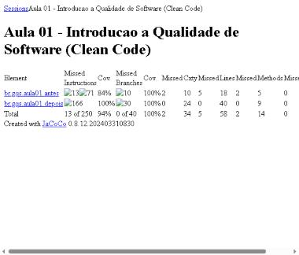
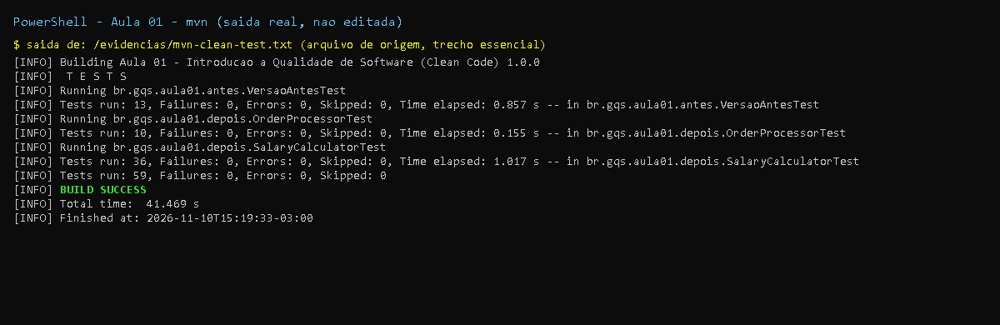

# Aula 1 - Introdução à Qualidade de Software

Disciplina: Introdução à Qualidade de Software com Java Avançado.
Tema: conceitos de qualidade e prática de **Clean Code** em Java (refatoração).

## 1. Resumo teórico

- **Qualidade de software** é o grau em que o produto atende às necessidades do usuário (requisitos) e, ao mesmo tempo, é fácil de manter, eficiente e com poucos defeitos. Qualidade não é só "não ter bug": inclui o custo de evoluir o código.
- **Modelos e normas:** a **ISO/IEC 25010** descreve a qualidade do *produto* (características como adequação funcional, confiabilidade, usabilidade, eficiência de desempenho, manutenibilidade, portabilidade, além de segurança e compatibilidade); **CMMI** e **MPS.BR** tratam da maturidade e melhoria do *processo* de desenvolvimento.
- **Por que importa:** reduz retrabalho e custo (defeito achado tarde custa mais), facilita manutenção e escalabilidade e melhora a experiência do usuário.
- **Pilares (do slide):** funcionalidade, confiabilidade, usabilidade, eficiência, manutenibilidade e portabilidade. Obs.: a versão atual da ISO 25010 (2011) reorganizou/ampliou essa lista (o slide usa a nomenclatura da ISO 9126, a antecessora).
- **Clean Code:** nomes significativos, funções pequenas com uma única responsabilidade, evitar duplicação (DRY), constantes nomeadas no lugar de números mágicos, validar entradas.

## 2. Enunciado das atividades

1. **Demonstração (slides):** refatorar `CalculoSalario` (nomes obscuros `s`, `d`, `sl`, `r`; método pouco legível; sem tratamento de valores negativos) para `SalaryCalculator`.
2. **Exercício dos alunos (20 min):** refatorar `OrderProcessor.calcTotal` aplicando Clean Code. Dicas: melhorar nomes, extrair a lógica de desconto para um método separado, adicionar validações (arrays não nulos e de mesmo tamanho).
3. **Encerramento:** discutir "qual impacto a refatoração tem na qualidade do software?" e (opcional) pesquisar ferramentas de análise estática (SonarQube, Checkstyle).

## 3. O que foi feito

Projeto Maven independente (Java 17, JUnit 5.10.2, JaCoCo para cobertura). Cada exercício tem a versão **antes** (ruim, mantida de propósito) e **depois** (limpa).

| Pacote | Classe | Papel |
|---|---|---|
| `br.gqs.aula01.antes` | `CalculoSalario` | versão ruim do slide |
| `br.gqs.aula01.antes` | `OrderProcessor` | versão ruim do exercício (`calcTotal`, variável `t`) |
| `br.gqs.aula01.depois` | `SalaryCalculator` | versão limpa: nomes claros, constantes de faixa/alíquota, `getTaxRate` separado, validação |
| `br.gqs.aula01.depois` | `OrderProcessor` | versão limpa: `calculateTotal` dividido em `validate`, `calculateSubtotal` e `applyDiscount` |

Melhorias aplicadas (e onde vão além do slide):

- Nomes descritivos (`grossSalary`, `netSalary`, `taxRate`, `subtotal`).
- Métodos pequenos e especializados (`getTaxRate`, `applyDiscount`, `validate`).
- Números mágicos viraram constantes nomeadas (`LIMITE_FAIXA_1`, `ALIQUOTA_FAIXA_1`, `DISCOUNT_THRESHOLD`, `DISCOUNT_RATE`).
- Validação de entrada: salário negativo, `NaN` e infinito; arrays nulos, de tamanhos diferentes, preços e quantidades negativos.

### Correções em relação aos slides

- No slide, `DISCOUNT_RATE = 0.9` "representa 10% de desconto": o nome mentia (0,9 é o **fator** a pagar, não a taxa). Na versão limpa a constante é `DISCOUNT_RATE = 0.10` e o cálculo é `subtotal * (1 - DISCOUNT_RATE)`.
- O slide só validava tamanhos diferentes; a dica do enunciado também pede arrays não nulos, o que foi implementado (mais preço/quantidade negativos, `NaN`).
- Mantive o `main` do slide em `SalaryCalculator` e acrescentei construtor privado (classe utilitária só com métodos estáticos). As mensagens de exceção foram mantidas em inglês como no slide.
- Limitação conhecida (documentada, não corrigida): os valores monetários usam `double` como no slide; em sistema real usar `BigDecimal`. Por isso os testes comparam com tolerância (delta).

## 4. Como rodar

Requisitos: JDK 17 e Maven 3.9.

```bash
cd aulas/aula-01-introducao-qualidade
mvn -B clean test
# relatório de cobertura: target/site/jacoco/index.html
```

## 5. Testes e evidências

- `VersaoAntesTest` (testes de **caracterização** da versão ruim): documenta o comportamento atual, inclusive as falhas (`-1000` vira "líquido" `-950`; arrays de tamanhos diferentes causam `ArrayIndexOutOfBoundsException`; `null` causa `NullPointerException`).
- `SalaryCalculatorTest`: todas as faixas e fronteiras (999,99 / 1000 / 1999 / 2000 / 3999 / 4000), entradas inválidas e **equivalência** entre a versão limpa e a ruim para entradas válidas.
- `OrderProcessorTest`: sem desconto em 1000 exatos (regra `> 1000`), desconto acima, pedido vazio, validações e equivalência com a versão ruim.

Resultado real da execução (`evidencias/mvn-clean-test.txt`): **59 testes, 0 falhas, 0 erros, BUILD SUCCESS** (13 + 10 + 36).

Cobertura (JaCoCo, `evidencias/jacoco.csv` e `evidencias/jacoco-relatorio.jpg`): versão `depois` com **100% de instruções e de ramos**; total do projeto 94% (as 13 instruções não cobertas são o `main` e o construtor padrão da classe ruim `CalculoSalario`).

## 6. Discussão: qual impacto a refatoração tem na qualidade do software?

Refatorar muda a **estrutura** sem mudar o **comportamento** visível, e por isso atua principalmente na **manutenibilidade** (legibilidade, facilidade de modificar e testar). Efeitos observados neste exercício:

- O código ficou mais fácil de ler e de testar: a regra de faixas isolada em `getTaxRate` pode ser testada sozinha.
- Ao extrair e nomear regras, apareceram defeitos latentes (salário negativo aceito, `0.9` com nome enganoso, arrays inconsistentes), o que aumenta a **confiabilidade**.
- Reduz o custo e o risco de mudanças futuras (por exemplo, mudar uma alíquota passa a ser editar uma constante).
- Só é segura com **testes** que garantam a equivalência de comportamento; aqui os testes comparam a versão limpa com a ruim.
- Custo: tempo gasto agora e risco de regressão se não houver testes.

## 7. Tarefa opcional: ferramentas de análise estática (pesquisa)

| Ferramenta | O que faz | Observação |
|---|---|---|
| **Checkstyle** | Verifica estilo/convenções de código (indentação, nomes, tamanho de linha, Javadoc). | Regras configuráveis (Sun, Google). Aplicado de fato na Aula 3 deste repositório. |
| **PMD** | Detecta más práticas e complexidade (variáveis não usadas, `if` aninhados, blocos vazios). | Foco em código-fonte; também usado na Aula 3. |
| **SonarQube** | Plataforma de qualidade contínua: bugs, vulnerabilidades, *code smells*, duplicação, cobertura e *quality gate*. | Exige servidor (não executado aqui; ver Aula 3). |
| **SpotBugs** | Procura padrões de bug no bytecode (NPE, comparação incorreta etc.). | Complementar às anteriores. |

Observação honesta: o item opcional foi apenas pesquisado/resumido nesta aula; nenhuma dessas ferramentas foi executada na Aula 1.

## 8. Itens não executados

Nenhum item obrigatório ficou de fora. O relatório JaCoCo em HTML foi capturado em imagem (resolução pequena, por causa do painel do navegador embutido); os dados completos estão no CSV.

## Prints

- `print-testes-*`: captura renderizada a partir da saida real do comando, salva em `evidencias/*.txt`.
- `print-github-*` (e `print-pr*`, `print-actions`): captura real da pagina publica do GitHub.
- Demais imagens (JaCoCo, Swagger, paginas): capturas reais geradas durante a execucao.





