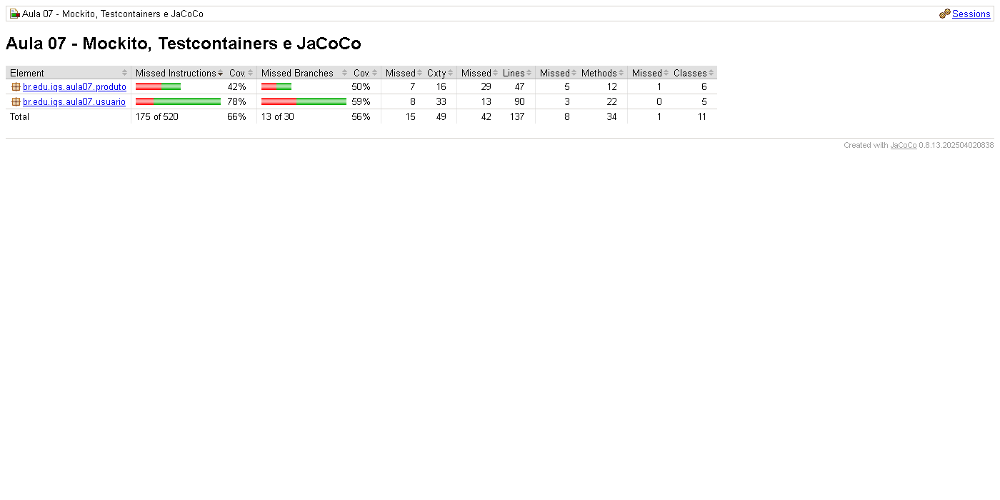
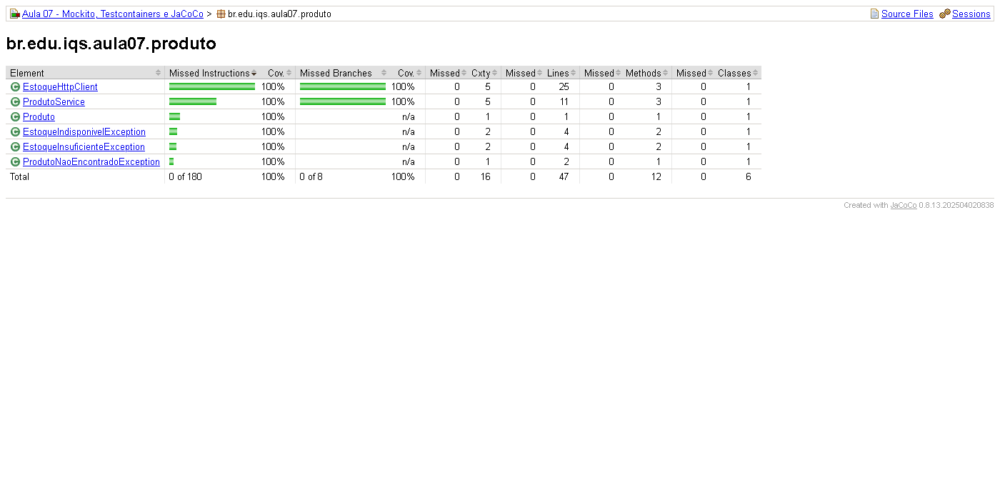
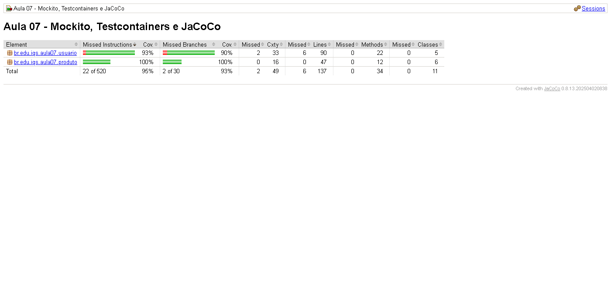
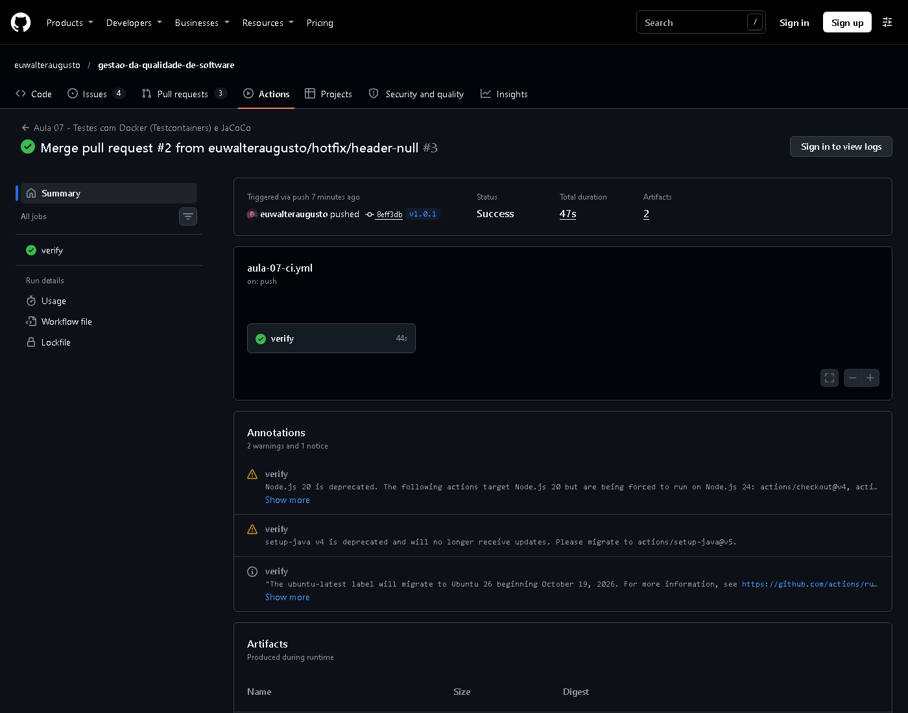
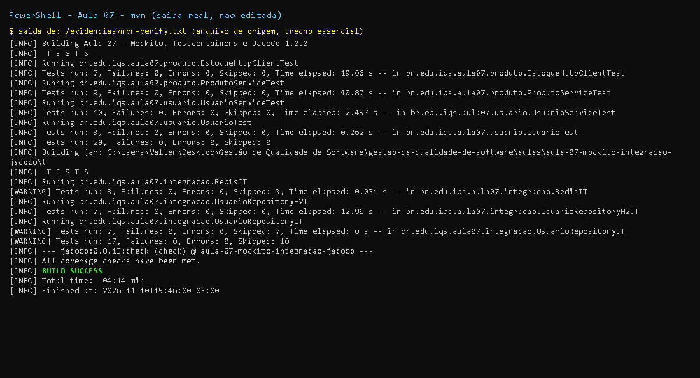

# Aula 7 - Mocking e Testes de Integração (Mockito, Testcontainers, JaCoCo)

Disciplina: Introdução à Qualidade de Software com Java Avançado.
Projeto Maven independente: Java 17, JUnit 5.10.2, Mockito 5.12.0, Testcontainers 1.21.4,
PostgreSQL 15 (container), H2 2.3.232, Jedis 5.2.0, JaCoCo 0.8.13, Surefire/Failsafe 3.2.5.

## Resumo teórico (em poucas palavras)

- **Mock (Mockito)**: objeto falso que substitui uma dependência lenta, externa ou imprevisível
  (banco, API HTTP, serviço complexo). Permite (1) **definir comportamento** (`when(...).thenReturn/thenThrow`),
  (2) **verificar interações** (`verify(mock, times(1)).metodo(...)`, `never()`, `ArgumentCaptor`) e
  isolar a classe testada. Teste unitário com mock é rápido e determinístico, mas só prova que a
  classe fala *como imaginamos* com a dependência.
- **Testcontainers**: sobe serviços reais (PostgreSQL, Redis, Kafka...) em containers Docker durante o
  teste: sobe o container, roda os testes, destrói o container. Valida SQL, constraints e transações
  de verdade e dispensa mocks complexos de banco.
- **JaCoCo**: mede cobertura (linhas, branches, instruções, complexidade ciclomática) a partir de um
  agente Java. Cobertura mostra *o que não foi executado*; não prova que o que foi executado está
  bem verificado (um teste sem `assert` também cobre linhas).

## Enunciado (entregas da aula)

1. Atividade 1: `UsuarioService` com `UsuarioRepository` mockado; exercícios: `buscarPorId` retornando
   `null` e teste de `salvarUsuario`.
2. Atividade 2: Testcontainers com PostgreSQL (`UsuarioRepositoryIT`); exercícios: `buscarTodos` e
   teste de transação (rollback).
3. Atividade 3: configurar JaCoCo (`mvn clean test` -> `target/site/jacoco/index.html`); exercício:
   identificar classe com baixa cobertura e implementar testes.
4. Desafio integrado: `ProdutoService` com `ProdutoRepository` e `EstoqueClient` (HTTP) mockados;
   `reservarEstoque()` deve chamar `EstoqueClient.reservar()` e lançar exceção se estoque insuficiente.
5. Discussão: quando usar mock vs container real?
6. Tarefas: Testcontainers com Redis; aumentar cobertura de uma classe para > 80%.

## O que foi feito

| Item | Onde |
|---|---|
| `UsuarioService`, `UsuarioRepository`, `Usuario`, exceções | `src/main/java/br/edu/iqs/aula07/usuario/` |
| Implementação real do repositório com JDBC (`UsuarioJdbcRepository`) | idem |
| Mockito: slide, `null`, `salvarUsuario` (com `ArgumentCaptor`), falha do repositório | `usuario/UsuarioServiceTest` |
| Desafio `ProdutoService` + `EstoqueClient` mockado (sucesso, estoque insuficiente, produto inexistente/inativo, quantidade inválida) | `src/main/java/.../produto/` e `produto/ProdutoServiceTest` |
| Cliente HTTP real (`EstoqueHttpClient`) testado contra servidor HTTP local de verdade | `produto/EstoqueHttpClientTest` |
| Testcontainers + PostgreSQL 15 (salvar, buscarPorId, **buscarTodos**, **rollback**, constraints) | `integracao/UsuarioRepositoryIT` |
| **Mesmos** cenários contra H2 (roda local sem Docker) | `integracao/UsuarioRepositoryH2IT` (contrato em `UsuarioJdbcRepositoryContrato`) |
| Tarefa Testcontainers + Redis (SET/GET, TTL, INCR/DECR) | `integracao/RedisIT` |
| JaCoCo (report no `test` e no `verify`) + regra de 80% de linhas (`check`) | `pom.xml` |
| CI com Docker (`mvn -B verify`) | `../../.github/workflows/aula-07-ci.yml` |

### Resultados reais

| Execução | Resultado |
|---|---|
| Unitários (surefire) | **29 testes, 0 falhas** |
| Integração (failsafe) | 17 testes: **7 passaram** (`UsuarioRepositoryH2IT`), **10 pulados** (Testcontainers sem Docker) |
| JaCoCo antes | linhas **69,3%** (95/137), branches 56,7%; `EstoqueHttpClient` com **0%** |
| JaCoCo depois | linhas **95,6%** (131/137), branches 93,3%; regra de >= 80% cumprida (`All coverage checks have been met`) |

### Limitações (honestidade)

- **Docker não existe nesta máquina**. Os testes com Testcontainers (`UsuarioRepositoryIT`, 7 testes, e
  `RedisIT`, 3 testes) foram **escritos por completo, mas NÃO executados aqui**: estão com
  `@Testcontainers(disabledWithoutDocker = true)` e aparecem como *Skipped*. Eles rodam no GitHub
  Actions (`aula-07-ci.yml`, runner `ubuntu-latest` com Docker). **Esse workflow ainda não foi
  executado** (nada foi enviado ao GitHub por esta entrega).
- Como compensação (e não como substituto), o **mesmo contrato** de testes do repositório JDBC roda
  contra H2 em modo PostgreSQL: isso validou de verdade a lógica JDBC, o `buscarTodos`, o commit e o
  **rollback**. H2 não é PostgreSQL (dialetos, tipos e bloqueios podem diferir), por isso o teste com
  PostgreSQL real continua necessário e é o que o CI executa.
- Após a mudança de cobertura, as 6 linhas descobertas restantes são os blocos `catch (SQLException)`
  de `criarTabelaSeNecessario`, `buscarPorId` e `buscarTodos`.

### Problemas dos slides corrigidos

1. **`MockitoAnnotations.openMocks(this)` no `@BeforeEach`** nunca fecha o recurso retornado e não
   falha para stubs inúteis. Substituído por `@ExtendWith(MockitoExtension.class)` (inicializa, fecha
   e ativa *strict stubs*).
2. **Testcontainers do slide está incompleto**: `repository` nunca é criado, o `DataSource` é só um
   comentário e `@BeforeAll` não faz nada. Foi implementado um `UsuarioJdbcRepository` real e a
   configuração do `DataSource` a partir de `postgres.getJdbcUrl()/getUsername()/getPassword()`.
3. **`mvn clean test` não executa testes `*IT`**: o Surefire só roda `*Test`. Foi adicionado o
   **Failsafe** (fase `integration-test`/`verify`), e o relatório JaCoCo completo é gerado em `verify`
   (o do slide, na fase `test`, ignoraria a cobertura dos testes de integração). O relatório da fase
   `test` foi mantido para ficar igual ao slide.
4. **`when(estoqueClient.reservar(...))` só compila se `reservar` retornar valor** (não pode ser
   `void`); definido como `int reservar(long, int)` (estoque restante).
5. **Versões**: Mockito 5.3.1 -> 5.12.0; Testcontainers 1.18.3 -> 1.21.4 (versões mais antigas
   têm incompatibilidade conhecida com engines Docker recentes); JaCoCo 0.8.10 -> 0.8.13; as duas
   dependências do Testcontainers passaram a usar o BOM para ficarem sempre na mesma versão.
6. `@Container static` com imagem `postgres:15-alpine` (mesma major do slide, imagem menor).
7. **Anti-padrão evitado**: testar `EstoqueHttpClient` com um mock do `HttpClient` apenas repetiria o
   código; ele é testado contra um servidor HTTP real em memória (`com.sun.net.httpserver`).

## Como rodar

```powershell
# Java 17 e Maven no PATH
mvn -B clean test      # unitários + relatório JaCoCo (igual ao slide): target/site/jacoco/index.html
mvn -B clean verify    # + integração (H2 sempre; PostgreSQL/Redis se houver Docker) + meta de 80%
```

Com Docker disponível, `mvn verify` executa também os 10 testes Testcontainers.
Para ver o `check` falhar de propósito (depois de um `verify`): `mvn jacoco:check@check -Dcobertura.minima=0.99`
(registrado em `evidencias/check-falha-proposital.txt`: BUILD FAILURE, "Coverage checks have not been met").

## Evidências (`evidencias/`)

- `mvn-verify-ANTES-baseline.txt`, `jacoco-antes.csv`, `jacoco-antes.png`: execução **antes** de
  escrever `EstoqueHttpClientTest` e `UsuarioTest` (69,3% de linhas; `-Djacoco.haltOnFailure=false`
  para o build não falhar na meta de 80%).
- `mvn-verify.txt`, `jacoco-depois.csv`, `jacoco-depois.png`, `jacoco-depois-pacote-produto.png`:
  execução final (95,6% de linhas, BUILD SUCCESS).
- Logs mostram `Skipped` nos testes Testcontainers (sem Docker). A saída tem a linha
  `Picked up JAVA_TOOL_OPTIONS: -Dfile.encoding=UTF-8`, usada apenas para o console exibir acentos.

## Discussão: quando usar mock vs container real?

- **Mock** para testar a *lógica da própria classe* isolada: ramificações de negócio, tratamento de
  erro (simular timeout, HTTP 500, exceção do repositório, difíceis de provocar de verdade). Vantagens:
  milissegundos, sem infraestrutura, determinístico. Risco: o mock reflete a nossa suposição, não a
  realidade (um `when` pode estar "certo" e o SQL real errado).
- **Container real** quando o valor está na *integração*: SQL e mapeamento, constraints
  (`UNIQUE`, `NOT NULL`), transações/rollback, versões e comportamento do banco, serialização com Redis.
  Custa mais (segundos, precisa de Docker) mas pega o que mock nunca pega.
- Regra prática (pirâmide de testes): muitos unitários com mock, poucos de integração com container
  nas fronteiras (banco, cache, mensageria); e não mockar o que você não é dono (ex.: driver JDBC),
  prefira o banco real.

## Tarefas

- **Redis com Testcontainers**: implementado em `RedisIT` (escrito, **não executado** localmente por
  falta de Docker; roda no CI).
- **Cobertura > 80%**: atingida e imposta pelo build (`jacoco:check`): 69,3% -> **95,6%**.

## Prints

- `print-testes-*`: captura renderizada a partir da saida real do comando, salva em `evidencias/*.txt`.
- `print-github-*` (e `print-pr*`, `print-actions`): captura real da pagina publica do GitHub.
- Demais imagens (JaCoCo, Swagger, paginas): capturas reais geradas durante a execucao.











