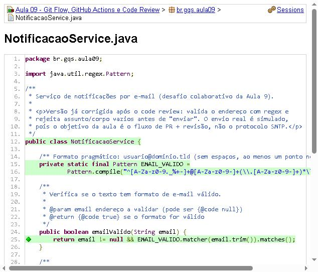
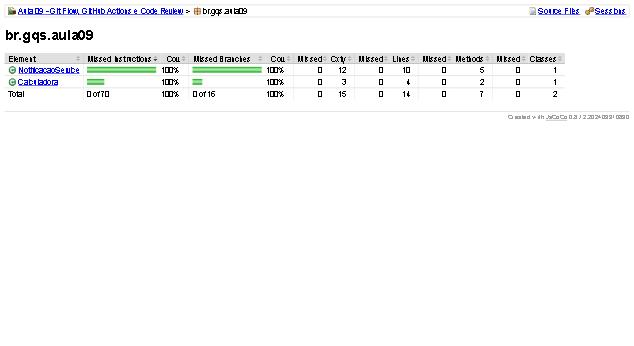
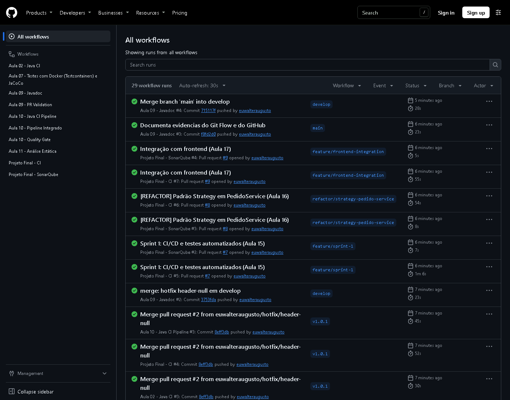
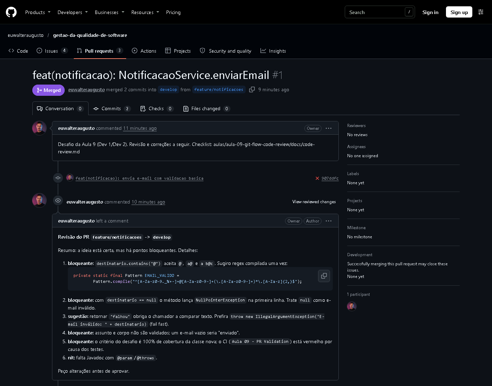
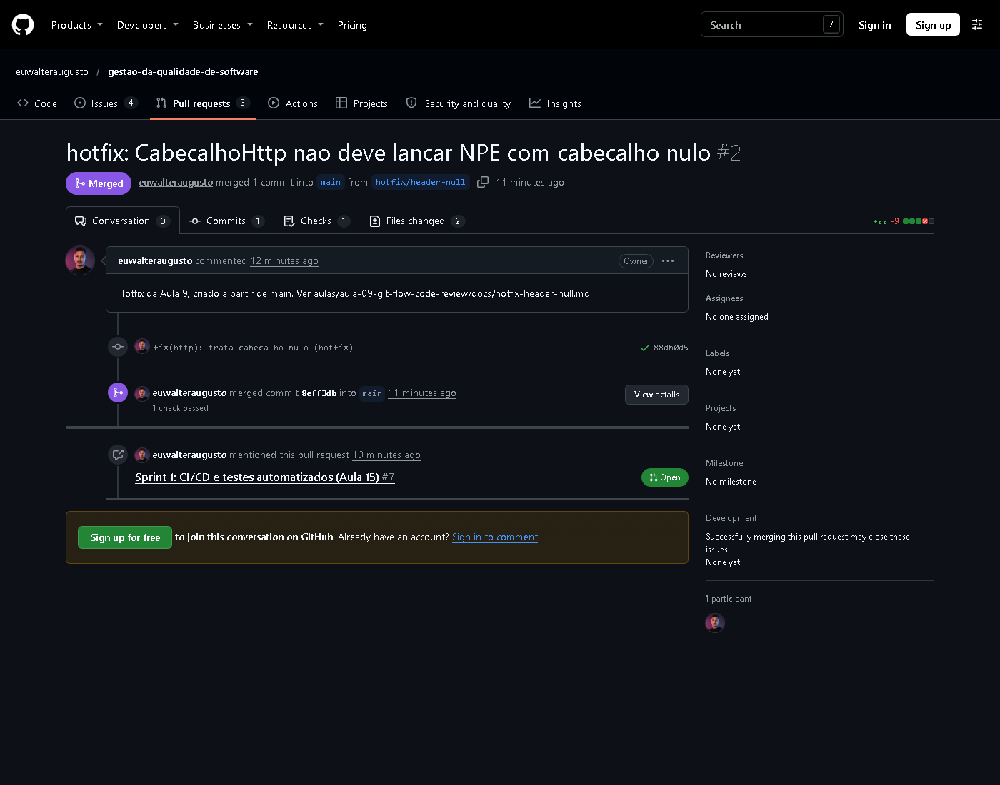
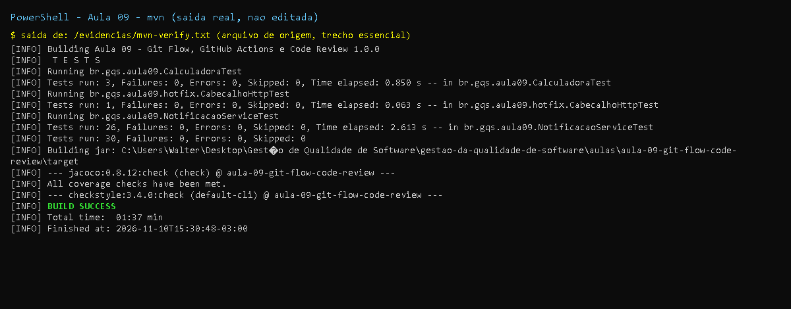

# Aula 9 - Versionamento e Git Avançado (Git Flow, GitHub Actions, Code Review)

Projeto Maven independente (Java 17, JUnit 5, JaCoCo, Checkstyle) com o código dos exercícios.
A parte de Git/GitHub (branches, PRs, tags) é executada pelo roteiro em
[`docs/git-flow-roteiro.md`](docs/git-flow-roteiro.md); os arquivos aqui já estão prontos.

## Entregas (exercícios, checklists e desafio do PDF)

| Item do PDF | Entrega | Onde |
|-------------|---------|------|
| Atividade 1: feature na branch + commits + PR | Roteiro com comandos exatos (feature, release, tag) | [`docs/git-flow-roteiro.md`](docs/git-flow-roteiro.md) |
| Exercício: `hotfix/header-null` a partir de `main` + commit de correção | Patch testado + passo a passo | [`docs/hotfix-header-null.md`](docs/hotfix-header-null.md), `docs/hotfix/header-null.patch` |
| Atividade 2: `pr-validation.yml` + branch protection | Workflow corrigido + configuração de proteção para repo solo | [`aula-09-pr-validation.yml`](../../.github/workflows/aula-09-pr-validation.yml), seção de proteção do roteiro |
| Atividade 3: code review de `Calculadora.divide` (antes/depois, comentários) | Antes, depois, testes e tabela de comentários | [`docs/code-review.md`](docs/code-review.md) |
| Desafio: `NotificacaoService.enviarEmail` (regex, testes, 100% cobertura) | Classe + 26 testes; regra JaCoCo exige 100% | `src/main/java/br/gqs/aula09/NotificacaoService.java`, `NotificacaoServiceTest` |
| Checklist de code review | Checklist completa | seção 3 de [`docs/code-review.md`](docs/code-review.md) |
| Tarefa: workflow que gera Javadoc | Workflow + execução local | [`aula-09-javadoc.yml`](../../.github/workflows/aula-09-javadoc.yml) |
| Tarefa: Conventional Commits | Resumo e exemplos | final do roteiro |

## Estrutura

```
aula-09-git-flow-code-review/
├── pom.xml                      # JUnit 5, JaCoCo (relatório + check 100%), Checkstyle
├── config/checkstyle.xml
├── src/main/java/br/gqs/aula09/
│   ├── NotificacaoService.java  # desafio (versão aprovada)
│   ├── Calculadora.java         # code review - DEPOIS
│   ├── revisao/antes/Calculadora.java   # code review - ANTES
│   └── hotfix/CabecalhoHttp.java        # defeito de produção p/ o exercício do hotfix
├── src/test/java/...            # testes
├── docs/                        # roteiro Git Flow, code review, hotfix, versões v1/v2 do PR
└── evidencias/                  # saídas reais dos comandos
```

## Como executar

```bash
cd aulas/aula-09-git-flow-code-review
mvn clean verify checkstyle:check      # testes + JaCoCo + regra de 100% + Checkstyle
# relatório de cobertura: target/site/jacoco/index.html
```

## Resultados reais (executados nesta máquina, JDK 17.0.21, Maven 3.9.9)

| Verificação | Resultado | Evidência |
|-------------|-----------|-----------|
| `mvn clean verify checkstyle:check` | BUILD SUCCESS, 30 testes, 0 falhas, 0 violações | `evidencias/mvn-verify.txt` |
| Cobertura `NotificacaoService` | 10/10 linhas, 14/14 ramos = 100%; `jacoco:check` passou | `evidencias/jacoco-resumo.txt` |
| `Calculadora.divide` antes x depois | `/ by zero` x `Divisor não pode ser zero` | `evidencias/antes-depois-divide.txt` |
| PR com erro (v1 do `NotificacaoService`) | Falha como esperado: 19 testes vermelhos (simula o CI vermelho do PR) | `evidencias/pr-v1-com-erro-mvn.txt` |
| Patch do hotfix aplicado sobre a árvore | `mvn verify checkstyle:check` passa (32 testes) | verificado em cópia temporária (descrito em `docs/hotfix-header-null.md`) |
| Javadoc | Gerado sem warnings | `evidencias/javadoc.txt` |
| Relatório JaCoCo (screenshots) | `NotificacaoService` e `Calculadora` 100% (a classe `revisao.antes.Calculadora` e `CabecalhoHttp` não entram na regra) | `evidencias/jacoco-pacote-aula09.jpg`, `evidencias/jacoco-notificacaoservice-fonte.jpg` |

## Correções em relação aos slides

| Slide | Problema | Correção |
|-------|----------|----------|
| `actions/checkout@v3`, `actions/setup-java@v3` | Versões antigas (Node 16 descontinuado) | `@v4` |
| `setup-java` sem `distribution` | Em v4 o campo é obrigatório (o slide da aula 9 omite) | `distribution: temurin` |
| `on: [pull_request]` sem filtro | Num monorepo rodaria para qualquer aula | `paths:` da própria aula + `defaults.run.working-directory` |
| Build sem cache | Lento | `cache: maven` |
| Sem `permissions` | Token com permissões amplas por padrão | `permissions: contents: read` |
| `throw ... # Fail fast` no slide | `#` não é comentário em Java (não compila) | `//` |
| "Aprovações (2 revisores)" | Impossível em repositório individual | Adaptação documentada na seção de branch protection |
| `mvn clean test` apenas | Não aplica a regra de cobertura nem o Checkstyle | `mvn clean verify` + `checkstyle:check` |

## Nao executado / pendente (depende do GitHub)

- Criação de `develop`, branches, PR, review, merge, release/tag e hotfix: **não executados aqui**
  (sem operações de Git nesta etapa); comandos exatos no roteiro.
- Execução real dos workflows `aula-09-pr-validation.yml` e `aula-09-javadoc.yml` no GitHub Actions:
  não executada localmente (os mesmos comandos Maven foram executados localmente com sucesso).
- Branch protection: configuração manual em Settings (descrita no roteiro).

## Links e prints a preencher (pelo orquestrador)

| Item | Link / arquivo |
|------|----------------|
| PR `feature/notificacoes` -> `develop` | [PR #1](https://github.com/euwalteraugusto/gestao-da-qualidade-de-software/pull/1), print em [evidencias/print-pr1-ci-vermelho.png](evidencias/print-pr1-ci-vermelho.png) |
| [evidencias/print-pr1-ci-vermelho.png](evidencias/print-pr1-ci-vermelho.png) |
| Print do check verde (v2) | _a preencher_ |
| Print dos comentários de review | _a preencher_ |
| [PR #2](https://github.com/euwalteraugusto/gestao-da-qualidade-de-software/pull/2), print em [evidencias/print-pr2-hotfix.png](evidencias/print-pr2-hotfix.png) |
| [evidencias/git-log-graph.txt](evidencias/git-log-graph.txt) |
| Print da regra de branch protection | _a preencher_ |

## Resultado da execução no GitHub

| Item | Evidência |
|---|---|
| PR da feature, CI **vermelho** com a v1 com erro | [PR #1](https://github.com/euwalteraugusto/gestao-da-qualidade-de-software/pull/1) (job `build` falhou, 22s) |
| Comentários de code review | [PR #1](https://github.com/euwalteraugusto/gestao-da-qualidade-de-software/pull/1) |
| Correção após review e merge em `develop` | [PR #1](https://github.com/euwalteraugusto/gestao-da-qualidade-de-software/pull/1) |
| Release `v1.0.0` (Git Flow: develop → release → main) | tag [v1.0.0](https://github.com/euwalteraugusto/gestao-da-qualidade-de-software/releases/tag/v1.0.0) |
| Hotfix `hotfix/header-null` a partir de `main`, CI **verde** | [PR #2](https://github.com/euwalteraugusto/gestao-da-qualidade-de-software/pull/2), tag [v1.0.1](https://github.com/euwalteraugusto/gestao-da-qualidade-de-software/releases/tag/v1.0.1) |
| Grafo de commits | [evidencias/git-log-graph.txt](evidencias/git-log-graph.txt) |

Limitações: o checkpoint de CI do segundo push do PR #1 não chegou a ser reportado pelo GitHub; a evidência do CI verde está no hotfix (PR #2). O GitHub não permite aprovar o próprio PR, então a aprovação foi substituída por comentários resolvidos (atividade feita a sós; não houve Dev 2/Dev 3 reais). Prints em PNG do CI não foram capturados; os links acima são as evidências.

## Prints

- `print-testes-*`: captura renderizada a partir da saida real do comando, salva em `evidencias/*.txt`.
- `print-github-*` (e `print-pr*`, `print-actions`): captura real da pagina publica do GitHub.
- Demais imagens (JaCoCo, Swagger, paginas): capturas reais geradas durante a execucao.













