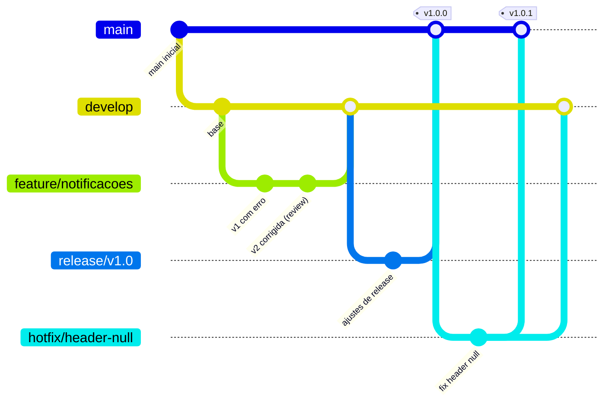

# Roteiro de Git Flow (Aula 9) - comandos exatos

Executar na **raiz do repositório** (`gestao-da-qualidade-de-software`), com `git` e `gh` autenticados.
Esta pasta já contém todos os arquivos prontos; o roteiro só faz o versionamento.
Itens `_a preencher_` são completados depois de executar (link de PR, print).

## Modelo de branches



| Branch | Origem | Destino do merge | Função |
|--------|--------|------------------|--------|
| `main` | - | - | produção (sempre estável, só recebe release/hotfix) |
| `develop` | `main` | `release/*` | integração das features |
| `feature/*` | `develop` | `develop` (via PR) | nova funcionalidade |
| `release/*` | `develop` | `main` e `develop` | estabilização e versão |
| `hotfix/*` | `main` | `main` e `develop` | correção urgente de produção |

## Passo 0 - criar `develop`

```bash
git checkout main && git pull origin main
git checkout -b develop
git push -u origin develop
```

## Passo 1 - Atividade 1: feature (cenário do slide: `feature/login`; desafio: `feature/notificacoes`)

O slide mostra `feature/login` com o commit "Implementa validação de senha". Para não criar código
sem utilidade, o fluxo é executado com a feature do **desafio** (`feature/notificacoes`); os comandos
são idênticos aos do slide trocando o nome da branch.

```bash
git checkout develop
git pull origin develop
git checkout -b feature/notificacoes

# Commit 1: versão COM ERROS (para o CI falhar e o PR receber revisão)
cp aulas/aula-09-git-flow-code-review/docs/code-review/NotificacaoService.v1-com-erro.java.txt \
   aulas/aula-09-git-flow-code-review/src/main/java/br/gqs/aula09/NotificacaoService.java
git add aulas/aula-09-git-flow-code-review .github/workflows/aula-09-pr-validation.yml .github/workflows/aula-09-javadoc.yml
git commit -m "feat(notificacao): envia e-mail com validacao basica"
git push -u origin feature/notificacoes
```

## Passo 2 - Atividade 2: PR + GitHub Actions (CI vermelho)

```bash
gh pr create --base develop --head feature/notificacoes \
  --title "feat(notificacao): NotificacaoService.enviarEmail" \
  --body "Desafio da Aula 9. Revisão e correções a seguir. Checklist: aulas/aula-09-git-flow-code-review/docs/code-review.md"
gh pr checks --watch        # esperado: job 'build' FALHA (testes não passam contra a v1)
```

Registrar: print do check vermelho -> `evidencias/pr-ci-vermelho.png` (_a preencher_).

## Passo 3 - Atividade 3: code review (papel Dev 3)

```bash
gh pr review --comment --body-file aulas/aula-09-git-flow-code-review/docs/code-review/comentarios-pr-notificacoes.md
# comentários pontuais por linha: pela interface do PR (aba "Files changed" -> "+")
```

Observação (aluno solo): o GitHub **não permite** `--request-changes` nem `--approve` no próprio
PR. O pedido de alterações fica registrado como comentário de revisão; a aprovação formal é
substituída por "todos os comentários resolvidos + CI verde" (critério de sucesso do slide).

## Passo 4 - correção (Dev 1) e merge

```bash
cp aulas/aula-09-git-flow-code-review/docs/code-review/NotificacaoService.v2-corrigida.java.txt \
   aulas/aula-09-git-flow-code-review/src/main/java/br/gqs/aula09/NotificacaoService.java
# remover as 2 linhas de cabeçalho-comentário do .txt (primeiras duas linhas começam com "//")
sed -i '1,2d' aulas/aula-09-git-flow-code-review/src/main/java/br/gqs/aula09/NotificacaoService.java
git diff --stat            # conferir: arquivo igual ao final da aula
git add -A aulas/aula-09-git-flow-code-review
git commit -m "fix(notificacao): valida e-mail por regex e rejeita assunto/corpo vazios (review)"
git push
gh pr checks --watch        # esperado: 'build' VERDE
# responder e resolver cada conversa do PR; depois:
gh pr merge --merge --delete-branch=false
```

| Item a preencher | Valor |
|------------------|-------|
| Link do PR | _a preencher_ |
| Print CI vermelho / verde | _a preencher_ |
| Print dos comentários de review | _a preencher_ |

## Passo 5 - release e tag

```bash
git checkout develop && git pull origin develop
git checkout -b release/v1.0
git push -u origin release/v1.0               # só estabilização/versão; sem features novas
git checkout main && git pull origin main
git merge --no-ff release/v1.0 -m "release: v1.0.0"
git tag -a v1.0.0 -m "Release 1.0.0"
git push origin main v1.0.0
git checkout develop
git merge --no-ff release/v1.0 -m "merge: release v1.0 em develop"
git push origin develop
git push origin --delete release/v1.0 && git branch -d release/v1.0
```

## Passo 6 - exercício: hotfix

Ver [`hotfix-header-null.md`](hotfix-header-null.md). Resumo: branch `hotfix/header-null` **a partir de
`main`**, commit com o patch `docs/hotfix/header-null.patch`, PR para `main`, tag `v1.0.1` e merge de
volta em `develop`.

## Passo 7 - evidência do grafo

```bash
git log --graph --oneline --decorate --all > aulas/aula-09-git-flow-code-review/evidencias/git-log-graph.txt
```

## Branch protection (Settings -> Branches -> Add rule), para `main` e `develop`

O slide pede "status checks + 2 aprovações". Adaptação para repositório solo:

- [x] Require a pull request before merging
- [x] Require status checks to pass -> selecionar **`build`** (job de `Aula 09 - PR Validation`;
      só aparece na lista depois de rodar ao menos uma vez)
- [x] Require conversation resolution before merging
- Aprovações: o slide pede 2, mas o autor não pode aprovar o próprio PR e não há outros membros.
  Opções: (a) 0 aprovações exigidas (adotado); (b) 1 aprovação e marcar "Allow specified actors to bypass"
  para o próprio dono. Em time real, manter 2.
- Cuidado: o workflow tem filtro `paths`; se uma regra exigir o check `build` e o PR não tocar nessa
  pasta, o check fica "pendente" para sempre. Por isso as regras de proteção só devem exigir o
  check em branches/PRs da aula 9 ou o filtro `paths` deve ser removido do workflow.

## Conventional Commits (tarefa de casa)

Formato `tipo(escopo): descrição no imperativo`. Tipos: `feat`, `fix`, `docs`, `test`, `refactor`,
`ci`, `chore`. Mudança incompatível: `feat!:` ou rodapé `BREAKING CHANGE:`. Exemplos usados aqui:
`feat(notificacao): ...`, `fix(cabecalho): ...`, `ci: ...`.
