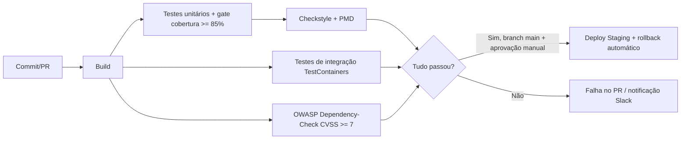
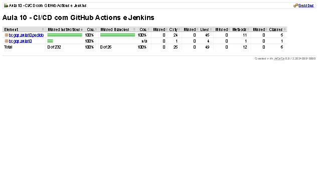
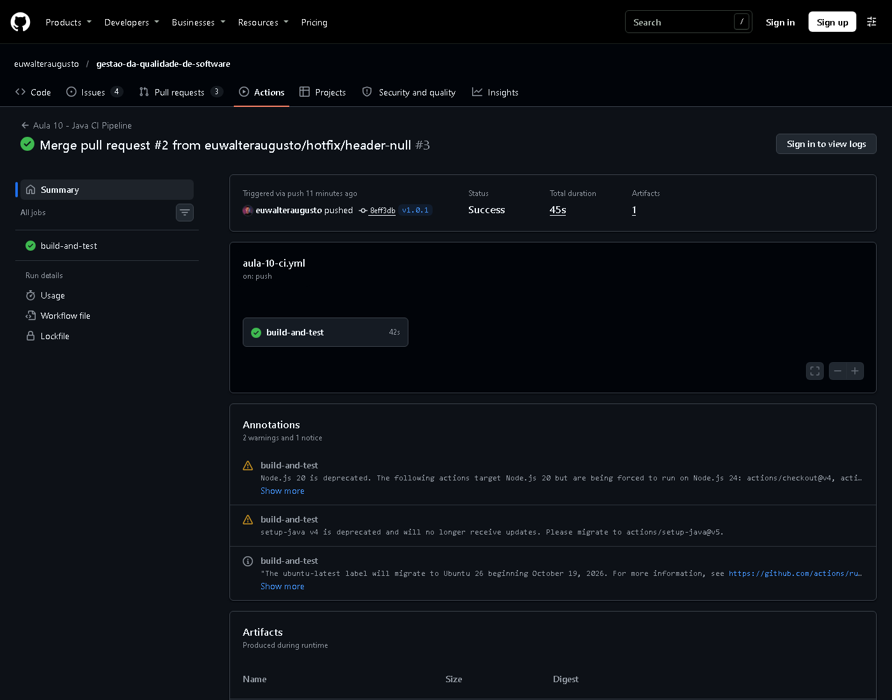
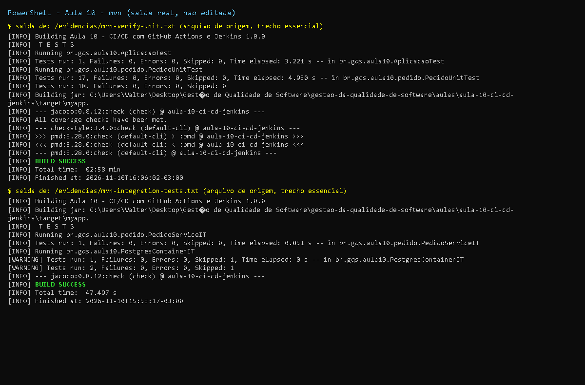

# Aula 10 - Integração Contínua (CI/CD) com Automação de Qualidade

Projeto Maven independente (Java 17) que serve de "aplicação-alvo" para os pipelines da aula:
fechamento de pedidos com desconto progressivo (`br.gqs.aula10.pedido`), testes unitários (`*Test`),
testes de integração (`*IT`, inclusive TestContainers/PostgreSQL), JaCoCo, Checkstyle, PMD e OWASP Dependency-Check.

## Entregas (exercícios e desafio do PDF)

| Item do PDF | Entrega | Arquivo |
|-------------|---------|---------|
| Atividade 1: `ci.yml` (build, testes, checkstyle) | Pipeline completo + PMD + gate de cobertura + upload de relatórios | [`aula-10-ci.yml`](../../.github/workflows/aula-10-ci.yml) |
| Exercício: relatório JaCoCo | `jacoco:report` no `pom.xml`, publicado como artefato | `pom.xml`, `aula-10-ci.yml` |
| Exercício: approval manual antes do deploy | `environment: staging` com "Required reviewers" (Jenkins: `input`) | `aula-10-pipeline-integrado.yml`, `Jenkinsfile` |
| Atividade 2: `Jenkinsfile` | Pipeline declarativo com testes paralelos, deploy condicionado a `main` | [`Jenkinsfile`](Jenkinsfile), `Dockerfile`, `k8s/deployment.yaml` |
| Exercício: estágio PMD | Estágio "Análise estática" (`pmd:check` + Checkstyle + `recordIssues`) | `Jenkinsfile`, `config/pmd-ruleset.xml` |
| Exercício: rollback automático no deploy | `try/catch` + `kubectl rollout undo` + `rollout status` | `Jenkinsfile` |
| Atividade 3: bloquear PRs (SonarQube `qualitygate.wait`) | Workflow com versão fixa da action, geração de cobertura e skip seguro sem secret | [`aula-10-quality-gate.yml`](../../.github/workflows/aula-10-quality-gate.yml), `sonar-project.properties` |
| Atividade 3: regras no SonarQube (cobertura 80%, zero bugs críticos, dívida < 1h) | Documentado abaixo (configuração é no servidor) | seção "Quality Gate no Sonar" |
| Desafio integrado: paralelo unit/integration; deploy só com testes OK, cobertura > 85%, sem vulnerabilidades OWASP | Pipeline com `needs`, gate JaCoCo e job OWASP | [`aula-10-pipeline-integrado.yml`](../../.github/workflows/aula-10-pipeline-integrado.yml) |
| Tarefa: pipeline completo do projeto final + OWASP | Mesmos arquivos servem de molde (copiar mudando `working-directory`) | - |

Diagrama do pipeline ideal (slide) com as decisões reais:



## Como executar localmente

```bash
cd aulas/aula-10-ci-cd-jenkins
mvn clean verify checkstyle:check pmd:check                  # unitários + JaCoCo + gate 85% + estilo + PMD
mvn clean verify -Pintegration-tests -Dtest=NenhumUnitario -Dsurefire.failIfNoSpecifiedTests=false -Djacoco.skip=true   # só *IT
NVD_API_KEY=... mvn verify -Psecurity -DskipTests            # OWASP (precisa de chave NVD)
java -jar target/myapp.jar                                   # imprime "Pedido PED-1 fechado. Total: 570.00"
```

## Resultados reais (executados nesta máquina: JDK 17.0.21, Maven 3.9.9)

| Verificação | Resultado | Evidência |
|-------------|-----------|-----------|
| `clean verify checkstyle:check pmd:check` | BUILD SUCCESS; 18 testes; 0 violações Checkstyle; PMD sem violações | `evidencias/mvn-verify-unit.txt` |
| Cobertura JaCoCo | 100% das linhas e ramos (49 linhas, 26 ramos) - gate de 85% atendido | `evidencias/jacoco-resumo.txt` |
| Relatório JaCoCo (screenshot) | 100% instruções e ramos | `evidencias/jacoco-index.jpg` |
| Gate de cobertura **falhando** (só 1 teste rodando) | `lines covered ratio is 0.83 / branches 0.50, expected minimum 0.85` -> BUILD FAILURE (simula a rejeição do PR com baixa cobertura) | `evidencias/mvn-gate-cobertura-falha.txt` |
| `jacoco:check@check` isolado (passo usado no `ci.yml`) | BUILD SUCCESS | `evidencias/mvn-jacoco-check-standalone.txt` |
| Perfil `integration-tests` (Failsafe) | `PedidoServiceIT` passou (1); `PostgresContainerIT` **pulado** (sem Docker), BUILD SUCCESS | `evidencias/mvn-integration-tests.txt` |

## Correções em relação aos slides

| Slide | Problema | Correção |
|-------|----------|----------|
| `actions/checkout@v3`, `setup-java@v3` | Versões antigas | `@v4` |
| `SonarSource/sonarqube-scan-action@master` | Ref mutável: risco de supply chain | Versão fixa `@v8.4.1` (release atual na data) |
| `mvn clean package` + `mvn test` | Testes rodavam duas vezes | `package -DskipTests` e testes em passo próprio |
| Sonar no slide sem build/cobertura | Quality gate de cobertura sempre em 0% | `mvn verify` gera `jacoco.xml` antes do scan |
| `-Dsonar.qualitygate.wait=true  # comentário` em `args` | `#` dentro de bloco `>` viraria argumento do scanner | Comentário removido (fica fora do bloco) |
| Desafio: `needs: build` num job que não existe | O job `build` não estava definido | Job `build` criado e usado em `needs` |
| `mvn verify -Pintegration-tests` sem perfil | Perfil não existia | Criado no `pom.xml` (Failsafe, `*IT`) |
| Jenkins: `sh 'mvn ...'` com `#` como comentário no slide | `#` não é comentário em Groovy | `//` |
| Jenkins: sem `tools`/credenciais | Dependia de configuração implícita | `tools { jdk 'JDK17'; maven 'Maven3' }` e `credentials('nvd-api-key')` |
| Deploy sem verificação nem volta | Falha deixava o cluster quebrado | `rollout status` + `rollout undo` |
| Jenkins: ramos paralelos no mesmo workspace | Corrida no `target/` | `stash/unstash` e `agent any` por ramo |
| OWASP Dependency-Check | Sem chave do NVD o download da base é muito lento/limitado | Chave via env `NVD_API_KEY` (secret), nunca no repositório |
| Gate "> 85%" | JaCoCo compara com `>=` | Mínimo 0.85 (`cobertura.minima`); cobertura real é 100%, margem ampla |

## Quality Gate no Sonar (configuração no servidor)

Em SonarQube/SonarCloud: *Quality Gates -> Create* e condições sobre **New Code**:
cobertura >= 80%, 0 bugs/vulnerabilidades críticas (Reliability/Security Rating A) e dívida técnica
(remediation) < 1h; depois *Set as default* ou associe ao projeto. O workflow só consome o resultado
(`sonar.qualitygate.wait=true`): se o gate falhar, o job falha e o PR fica bloqueado quando o check for
exigido na branch protection. Detalhes de instalação e leitura de métricas: aula 11.

## Secrets e configuração no GitHub

| Nome | Onde | Uso |
|------|------|-----|
| `NVD_API_KEY` | Actions secret | OWASP Dependency-Check (solicitar em nvd.nist.gov/developers/request-an-api-key) |
| `SONAR_TOKEN` | Actions secret | Quality gate |
| `SONAR_HOST_URL` | Actions secret | URL do SonarQube (omitir no SonarCloud) |
| `staging` | Settings -> Environments | Marcar "Required reviewers" = aprovação manual antes do deploy |
| Jenkins `nvd-api-key` | Credentials (Secret text) | Mesmo uso no Jenkinsfile |
| Webhook (slide) | GitHub -> Settings -> Webhooks -> `http://jenkins-server/github-webhook/` | Disparar o Jenkins no push |

Todos os workflows pulam os passos que dependem de secret com um aviso (`::warning`) em vez de falhar
quando o secret não existe.

## Não executado / limitações (honestidade)

- **Jenkinsfile**: não executado (não há Jenkins nesta máquina). Foi revisado manualmente quanto à sintaxe declarativa; precisa validar em um Jenkins real (plugins: Pipeline, JUnit, Warnings NG, JaCoCo, Slack Notification).
- **Docker/Kubernetes**: `Dockerfile`, `k8s/deployment.yaml`, `docker build`, `kubectl apply`, rollback e `rollout undo` **não executados** (sem Docker/cluster). O workflow faz `docker build` + `docker run` real no runner do GitHub, mas o deploy no cluster é apenas ecoado (precisaria de kubeconfig em secret).
- **TestContainers**: `PostgresContainerIT` compila e foi *pulado* aqui (`disabledWithoutDocker`); ele executa no `ubuntu-latest` do GitHub Actions.
- **OWASP Dependency-Check**: perfil `security` configurado, mas **não executado** (exige `NVD_API_KEY` e baixar a base do NVD). Sem o secret o job do workflow é pulado com aviso.
- **SonarQube/SonarCloud**: scan não executado (sem servidor/conta); ver aula 11 para a substituição por PMD/Checkstyle.
- **Workflows**: não executados no GitHub Actions por mim; os comandos Maven equivalentes foram executados localmente. A sintaxe YAML dos workflows e do `k8s/deployment.yaml` foi validada localmente com SnakeYAML (`evidencias/yaml-valido.txt`; só sintaxe, não o esquema do GitHub Actions).
- Para o orquestrador: criar os secrets acima, o environment `staging` e, se desejado, exigir os checks em branch protection.

## Prints

- `print-testes-*`: captura renderizada a partir da saida real do comando, salva em `evidencias/*.txt`.
- `print-github-*` (e `print-pr*`, `print-actions`): captura real da pagina publica do GitHub.
- Demais imagens (JaCoCo, Swagger, paginas): capturas reais geradas durante a execucao.







