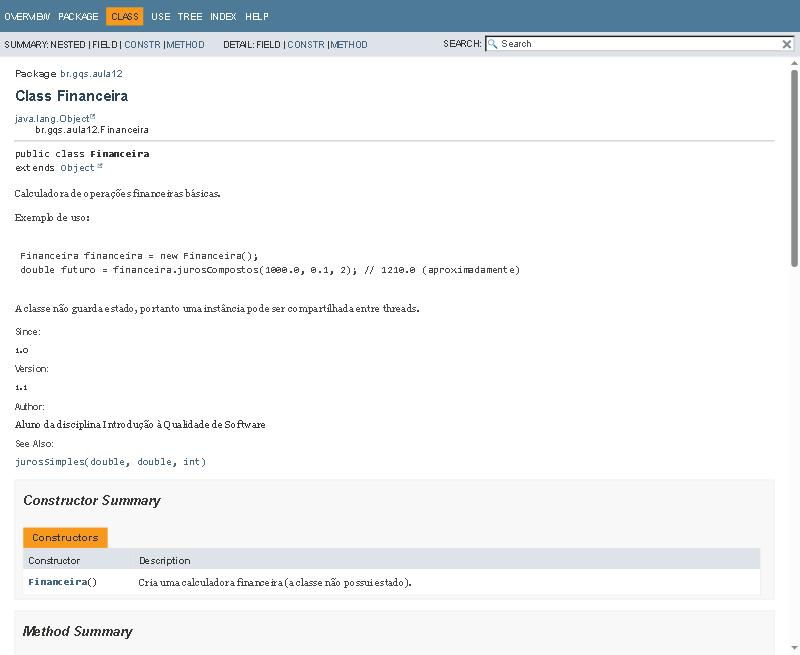
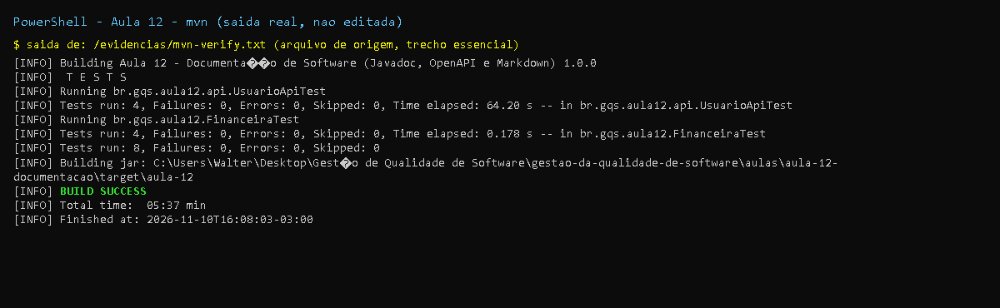
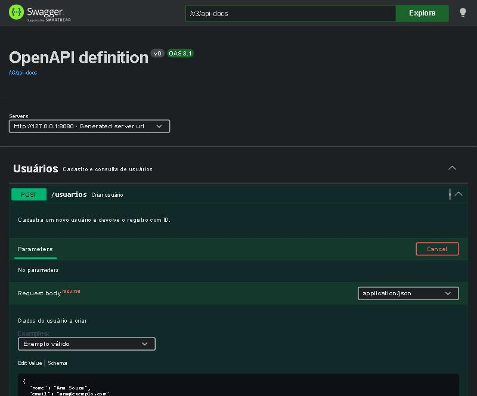

# Aula 12 - Documentação de Software (Javadoc, OpenAPI/Swagger e Markdown)

Mini API REST de usuários (Spring Boot 3 + springdoc-openapi) mais uma classe de biblioteca (`Financeira`)
usadas para praticar os três níveis de documentação da aula: **código** (Javadoc), **API** (OpenAPI/Swagger)
e **sistema** (Markdown/Confluence).

## Requisitos

- Java 17+
- Maven 3.9+
- Nenhum banco de dados (armazenamento em memória; o README de exemplo do slide cita PostgreSQL, aqui não é necessário)

## Como executar

```bash
cd aulas/aula-12-documentacao
mvn spring-boot:run                      # sobe em http://localhost:8080
# Swagger UI:      http://localhost:8080/swagger-ui.html   (redireciona para /swagger-ui/index.html)
# OpenAPI (JSON):  http://localhost:8080/v3/api-docs
mvn clean verify                         # 8 testes (inclusive o que valida o contrato OpenAPI)
mvn javadoc:javadoc                      # HTML em target/reports/apidocs/index.html (doclint=all, falha com warning)
mvn site                                 # site em target/site (inclui Javadoc, dependências e relatório de testes)
```

Teste rápido (outro terminal):

```bash
curl -X POST http://localhost:8080/usuarios -H "Content-Type: application/json" \
     -d '{"nome":"Ana Souza","email":"ana@exemplo.com"}'
curl http://localhost:8080/usuarios/1
```

## Rotas principais

| Endpoint | Método | Descrição | Respostas |
|----------|--------|-----------|-----------|
| `/usuarios` | POST | Cria um usuário (corpo `NovoUsuarioRequest`) | 201, 400 |
| `/usuarios/{id}` | GET | Obtém um usuário por ID | 200, 404 |

Contrato completo exportado de `/v3/api-docs` com a aplicação rodando (OpenAPI 3.1): [`docs/openapi.json`](docs/openapi.json). Chamadas reais de exemplo (201, 200, 404, 400): `evidencias/curl-api.txt`.

## Entregas (exercícios, desafio e tarefa do PDF)

| Item do PDF | Entrega | Onde |
|-------------|---------|------|
| Atividade 1: classe documentada (`@author`, `@version`, `@throws`, `@param`, `@return`) | `Financeira` | `src/main/java/br/gqs/aula12/Financeira.java` |
| Atividade 1: gerar HTML (`mvn javadoc:javadoc`) | HTML gerado sem warnings | `evidencias/mvn-javadoc.txt`, `evidencias/javadoc-financeira.jpg` |
| Exercício: exemplo de uso (`{@code}`) e link para método relacionado (`@see`) | `Financeira` (`{@code}`, `<pre>{@code}</pre>`, `@see`, `@since`) + `package-info.java` | idem |
| Atividade 2: springdoc + anotações no controller | `UsuarioController` com `@Operation`, `@ApiResponses`, `@Parameter` | `src/main/java/br/gqs/aula12/api/` |
| Exercício: endpoint POST com schema do `requestBody` | `POST /usuarios` com `@RequestBody` + `@Schema` + `@ExampleObject` + Bean Validation | `UsuarioController`, `NovoUsuarioRequest` |
| Atividade 3: README.md ágil | Este arquivo | `README.md` |
| Atividade 3: template Confluence | Template preenchido | [`docs/confluence-template.txt`](docs/confluence-template.txt) |
| Exercício: `ARCHITECTURE.md` (Mermaid + decisões) | Diagrama de componentes + Decision Records | [`docs/ARCHITECTURE.md`](docs/ARCHITECTURE.md) |
| Desafio: Javadoc sem warnings; Swagger UI com exemplos; README permitindo execução local | `doclint=all` + `failOnWarnings`; exemplos no Swagger; seção "Como executar" | `pom.xml`, `evidencias/swagger-ui.jpg` |
| Tarefa: documentar 2 endpoints com OpenAPI; gerar site (`mvn site`) | 2 endpoints + `mvn site` executado | `docs/openapi.json`, `evidencias/mvn-site.txt` |

## Documentação em camadas (Hierarquia do slide)

| Nível | Ferramenta | Público | Aqui |
|-------|-----------|---------|------|
| Código | Javadoc, anotações | Devs | `Financeira`, `api/*` |
| API | Swagger/OpenAPI | Frontend/Integração | `/swagger-ui.html`, `docs/openapi.json` |
| Sistema | Markdown, Confluence | POs, stakeholders | `README.md`, `docs/ARCHITECTURE.md`, `docs/confluence-template.txt` |

Princípios aplicados: **viva** (gerada do código e verificada por teste/build), **buscável** (estrutura fixa,
Markdown indexável) e **relevante** (só o que não é óbvio; sem Javadoc que repete o nome do método).

## Escolha: Spring Boot + springdoc (e não só um `openapi.yaml`)

Foi escolhido o mini-exemplo Spring Boot porque o próprio slide pede "Swagger UI deve mostrar exemplos" e a UI só
existe com a aplicação rodando. O custo é maior (dependências do Spring), mas o contrato fica sempre sincronizado
com o código e é validado por teste automatizado.

## Correções em relação aos slides

| Slide | Problema | Correção |
|-------|----------|----------|
| `springdoc-openapi-ui` 1.7.0 | Biblioteca para Spring Boot 2 (`javax.*`); não funciona com Spring Boot 3 | `springdoc-openapi-starter-webmvc-ui` 2.8.17 |
| `.java` do material usa `@author Douglas Duarte` e o PDF usa `Maria Silva` | Inconsistência entre PDF e `.java` | `@author` genérico da disciplina |
| `Financeira` do slide sem construtor/`@since`/exemplos | Javadoc incompleto frente ao exercício (`@code`, `@see`) | Adicionados; `doclint=all` passa |
| `mvn javadoc:javadoc` -> `target/site/apidocs` | Em Maven 3.9 o goal direto grava em `target/reports/apidocs` (`target/site/apidocs` só no `mvn site`) | Caminhos corrigidos neste README |
| `README` do slide com bloco de código sem fechar e `## Rotas` colado | Markdown quebrado | Blocos fechados |
| Rota `/swagger-ui.html` | Redireciona para `/swagger-ui/index.html` | Documentado |
| "Arquivo `ARCHITECTURE.md`" | Sem local definido | `docs/ARCHITECTURE.md` |

## Não executado / limitações

- Template do Confluence (`docs/confluence-template.txt`) é só o texto no markup wiki do Confluence; **não foi colado em uma instância Confluence** (não há acesso).
- Nenhum deploy/CI para esta aula foi pedido; não há workflow para a Aula 12 (o Javadoc é gerado localmente).

## Prints

- `print-testes-*`: captura renderizada a partir da saida real do comando, salva em `evidencias/*.txt`.
- `print-github-*` (e `print-pr*`, `print-actions`): captura real da pagina publica do GitHub.
- Demais imagens (JaCoCo, Swagger, paginas): capturas reais geradas durante a execucao.







