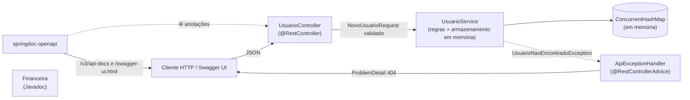

# Arquitetura (Aula 12, Atividade 3: `ARCHITECTURE.md`)

## Diagrama de componentes (Mermaid)

| Componente | Responsabilidade |
|------------|------------------|
| `UsuarioController` | Mapeia HTTP, valida o corpo (`@Valid`) e documenta cada operação (`@Operation`, `@ApiResponse`) |
| `UsuarioService` | Regras de negócio e armazenamento em memória (thread-safe) |
| `ApiExceptionHandler` | Traduz exceções em respostas `ProblemDetail` (RFC 9457) |
| springdoc-openapi | Gera `/v3/api-docs` (OpenAPI 3) e a Swagger UI a partir das anotações |
| `Financeira` | Exemplo de classe de biblioteca com Javadoc completo |

## Decisões técnicas (Decision Records)

| Data | Decisão | Razão | Alternativa descartada |
|------|---------|-------|------------------------|
| 2026-11-10 | Springdoc `springdoc-openapi-starter-webmvc-ui` 2.8.x | O slide usa `springdoc-openapi-ui` 1.7.0, que só funciona com Spring Boot 2 (`javax`); este projeto usa Spring Boot 3 (`jakarta`) | Manter 1.7.0 (não inicia em Spring Boot 3) |
| 2026-11-10 | Documentação gerada do código (anotações), com arquivo `docs/openapi.json` exportado | Documentação "viva": muda junto com o código | `openapi.yaml` escrito à mão (desatualiza) |
| 2026-11-10 | Armazenamento em memória | Foco da aula é documentar, não persistir | PostgreSQL (o README do slide cita; fora de escopo) |
| 2026-11-10 | Erros em `ProblemDetail` | Formato padrão, documentado no OpenAPI | JSON de erro próprio |
| 2026-11-10 | Javadoc com `doclint=all` e `failOnWarnings` | Critério do desafio: HTML sem warnings, garantido no build | Só gerar e olhar |
| 2026-11-10 | Mermaid dentro do Markdown | Versionado junto ao código, renderiza no GitHub | Imagem exportada de ferramenta externa |

## Como a documentação se mantém viva

- Javadoc: `mvn javadoc:javadoc` falha se um método público ficar sem `@param`/`@return`/`@throws`.
- OpenAPI: o teste `UsuarioApiTest.documentacaoOpenApiDescreveOsDoisEndpointsComExemplos` quebra se
  um endpoint perder o resumo ou o exemplo.
- Markdown: README e este arquivo são revisados no mesmo PR que muda o comportamento (item do checklist de code review da Aula 9).
