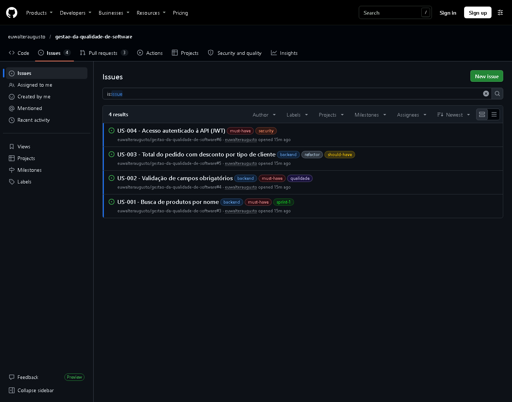
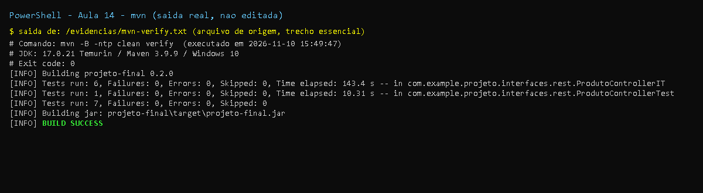

# Aula 14 - User Stories e Planejamento

## Objetivo

Transformar requisitos em User Stories acionaveis, implementar um endpoint guiado por User Story
(US-001 - busca por nome) e preparar a gestao agil (GitHub Projects) e a analise SonarQube.

## Entregas

- **US-001 implementada**: `GET /produtos/buscar?nome=...` (query method `findByNomeContainingIgnoreCase`)
- **Testes de integracao** novos: `deveBuscarProdutosPorNome` e `deveRetornarListaVaziaQuandoBuscaNaoEncontra`
- **User Stories** (US-001 + 3 adicionais da tarefa pos-aula: US-002 validacao, US-003 total do pedido com desconto, US-004 autenticacao JWT) com criterios de aceitacao, MoSCoW e **sugestao de issues/labels/board**: [user-stories.md](user-stories.md)
- **Definition of Done** no [README do projeto](../../README.md#definition-of-done-dod)
- **Workflow SonarQube** (tarefa pos-aula "webhook GitHub-SonarQube"): `.github/workflows/projeto-final-sonar.yml`
- Propriedades `sonar.*` no `pom.xml` (chave do projeto e caminho do XML do JaCoCo)

## Arquivos adicionados/alterados nesta aula

```
A .github/workflows/projeto-final-sonar.yml
M projeto-final/pom.xml                                  (versao 0.2.0 + propriedades sonar.*)
M projeto-final/README.md                                (tabela de aulas + Definition of Done)
M projeto-final/src/main/java/com/example/projeto/domain/model/Produto.java          (construtores)
M projeto-final/src/main/java/com/example/projeto/domain/repository/ProdutoRepository.java (query method)
M projeto-final/src/main/java/com/example/projeto/interfaces/rest/ProdutoController.java   (GET /buscar)
M projeto-final/src/test/java/com/example/projeto/interfaces/rest/ProdutoControllerIT.java (2 testes)
A projeto-final/docs/aula-14/README.md
A projeto-final/docs/aula-14/user-stories.md
A projeto-final/docs/aula-14/evidencias/*
```

Patch exato: [`mudancas.patch`](mudancas.patch).

## Correcoes em relacao aos slides

| Slide | Problema | Correcao |
|-------|----------|----------|
| `findByNomeContaining(nome)` | Busca sensivel a maiusculas: `xiaomi` nao encontra `Xiaomi`, o que nao atende a intencao da US | `findByNomeContainingIgnoreCase` |
| `new Produto("Smartphone Xiaomi")` | A entidade da aula 13 nao tinha esse construtor | Construtores `Produto(String)` e `Produto(String, BigDecimal)` |
| `SonarSource/sonarqube-scan-action@master` | Referencia mutavel (`@master`) - risco de supply chain e quebra sem aviso; o scanner generico tambem nao e o recomendado para projetos Maven | Scanner Maven (`sonar-maven-plugin`) apos `mvn verify`, actions `@v4` |
| `actions/checkout@v3` | Versao antiga | `actions/checkout@v4` com `fetch-depth: 0` |
| Workflow falha sem secret | Em forks ou sem configuracao o job quebraria | Analise condicionada a existencia do secret `SONAR_TOKEN` (caso contrario, aviso e sucesso) |

## Pendencias para o dono do repositorio (nao executaveis localmente)

- **GitHub Projects**: criar o board (Backlog | To Do | In Progress | Done) e as issues US-001..US-004 (comandos `gh` em [user-stories.md](user-stories.md#sugestao-de-issues-para-o-github-projects)).
- **Branch/PR**: `feature/us-001-busca-produtos` + PR vinculado a issue US-001 (`closes #1`).
- **SonarQube/SonarCloud**: criar o projeto `gqs-projeto-final` e cadastrar os secrets `SONAR_TOKEN` e `SONAR_HOST_URL` (e a variable `SONAR_ORGANIZATION`, se SonarCloud). Sem conta externa a analise **nao foi executada localmente**.

## Evidencias

- [`evidencias/mvn-verify.txt`](evidencias/mvn-verify.txt) - `mvn clean verify`
- [`evidencias/jacoco-resumo.txt`](evidencias/jacoco-resumo.txt) - cobertura
- [`evidencias/curl-endpoints.txt`](evidencias/curl-endpoints.txt) - busca por nome executada com `curl`

Resultado: **7 testes, 0 falhas**; cobertura de linhas 83,3% (20/24). Ainda sem verificacao
automatica de cobertura minima - o `jacoco:check` (>= 80%) entra na aula 15. Observacao: a busca sem o
parametro `nome` devolvia o erro padrao do Spring (`400` sem detalhe util); padronizado com
ProblemDetail na aula 15.

## Prints

- `print-testes-*`: captura renderizada a partir da saida real do comando, salva em `evidencias/*.txt`.
- `print-github-*` (e `print-pr*`, `print-actions`): captura real da pagina publica do GitHub.
- Demais imagens (JaCoCo, Swagger, paginas): capturas reais geradas durante a execucao.





