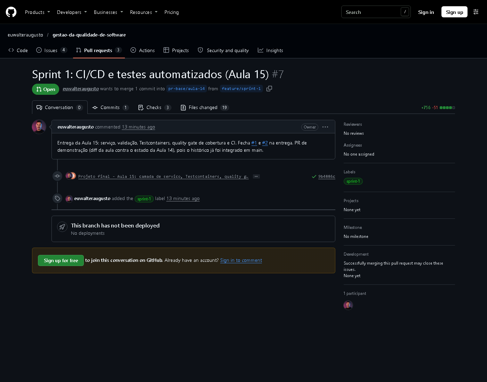
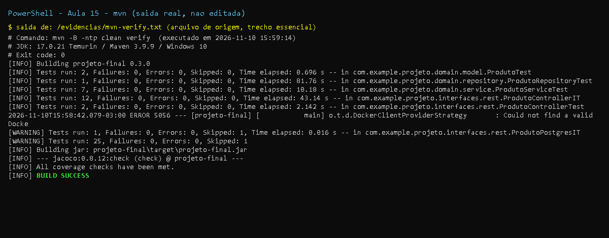

# Aula 15 - Sprint 1: CI/CD e Testes Automatizados

## Objetivo

Pipeline CI/CD no GitHub Actions, testes automatizados para as funcionalidades novas
(piramide de testes / principios FIRST) e qualidade garantida por ferramentas.

## Entregas

| Item | Onde |
|------|------|
| Pipeline CI: build -> testes -> cobertura -> (main) deploy | `.github/workflows/projeto-final-ci.yml` |
| Analise SonarQube (condicionada ao secret) | `.github/workflows/projeto-final-sonar.yml` (aula 14) |
| Camada de servico `ProdutoService` + `ProdutoNaoEncontradoException` | `domain/service` |
| Teste unitario do service (slide) + cenarios extras | `ProdutoServiceTest` (7 testes, Mockito) |
| Teste com **Testcontainers + PostgreSQL 15** | `ProdutoPostgresIT` (`@Testcontainers(disabledWithoutDocker = true)`) |
| Teste so da camada JPA (dica `@DataJpaTest`) | `ProdutoRepositoryTest` |
| Melhoria apontada pela analise estatica: NPE em `getPrecoFormatado` | `Produto#getPrecoFormatado` + `ProdutoTest` |
| **Tarefa pos-aula**: teste de validacao de campos obrigatorios (US-002) | `ProdutoRequest` (Bean Validation) + `ApiExceptionHandler` + teste parametrizado em `ProdutoControllerIT` |
| **Tarefa pos-aula**: estagio de deploy Heroku no CI | job `deploy-heroku` (so na `main`, so com secrets) |
| Cobertura minima no build | `jacoco:check` - linhas >= 80%, branches >= 70% (falha o `mvn verify`) |

Piramide atual: unitarios (`ProdutoTest`, `ProdutoServiceTest`, `ProdutoControllerTest`) na base;
integracao (`ProdutoRepositoryTest`, `ProdutoControllerIT`, `ProdutoPostgresIT`) acima.

## Testcontainers e Docker

Nao ha Docker nesta maquina de desenvolvimento. O teste `ProdutoPostgresIT` foi escrito de verdade
(container `postgres:15-alpine`, `@DynamicPropertySource` com URL/usuario/senha) e anotado com
`@Testcontainers(disabledWithoutDocker = true)`: localmente ele aparece como **skipped** no relatorio
(ver `evidencias/mvn-verify.txt`), e no GitHub Actions (`ubuntu-latest` tem Docker - o workflow
inclusive imprime a versao do Docker antes do build) ele **executa contra um PostgreSQL real**.

## Arquivos adicionados/alterados nesta aula

```
M .github/workflows/projeto-final-ci.yml        (Docker check, artefatos, job deploy-heroku)
M projeto-final/pom.xml                          (0.3.0; validation, testcontainers, postgresql(test), jacoco:check)
M projeto-final/README.md
M projeto-final/src/main/java/com/example/projeto/domain/model/Produto.java        (getPrecoFormatado null-safe)
A projeto-final/src/main/java/com/example/projeto/domain/service/ProdutoService.java
A projeto-final/src/main/java/com/example/projeto/domain/service/ProdutoNaoEncontradoException.java
M projeto-final/src/main/java/com/example/projeto/interfaces/rest/ProdutoController.java (usa service + @Valid)
A projeto-final/src/main/java/com/example/projeto/interfaces/rest/ProdutoRequest.java
A projeto-final/src/main/java/com/example/projeto/interfaces/rest/ApiExceptionHandler.java
A projeto-final/src/test/java/com/example/projeto/domain/model/ProdutoTest.java
A projeto-final/src/test/java/com/example/projeto/domain/repository/ProdutoRepositoryTest.java
A projeto-final/src/test/java/com/example/projeto/domain/service/ProdutoServiceTest.java
M projeto-final/src/test/java/com/example/projeto/interfaces/rest/ProdutoControllerIT.java (validacao, ProblemDetail)
M projeto-final/src/test/java/com/example/projeto/interfaces/rest/ProdutoControllerTest.java (mock do service)
A projeto-final/src/test/java/com/example/projeto/interfaces/rest/ProdutoPostgresIT.java
A projeto-final/docs/aula-15/README.md
A projeto-final/docs/aula-15/evidencias/*
```

Patch exato: [`mudancas.patch`](mudancas.patch).

## Correcoes em relacao aos slides

| Slide | Problema | Correcao |
|-------|----------|----------|
| `actions/checkout@v3`, `actions/setup-java@v3` | Versoes antigas (runtime Node 16 descontinuado) | `@v4` + cache Maven |
| `SonarSource/sonarqube-scan-action@master` no CI | Referencia mutavel; quebra o CI sem secrets | Sonar em workflow proprio, scanner Maven, condicionado ao `SONAR_TOKEN` |
| `on: [push, pull_request]` sem filtro | Monorepo: rodaria para qualquer pasta | `paths: projeto-final/**` + `working-directory: projeto-final` |
| `@Testcontainers` sem configuracao para ambiente sem Docker | Sem Docker o teste falha com erro (nao e "skip") | `@Testcontainers(disabledWithoutDocker = true)` |
| `@DynamicPropertySource` so com a URL | Sem `username`/`password` o Spring usa `sa`/vazio do H2 e a conexao com o PostgreSQL falha | Registra URL, usuario, senha, driver e `ddl-auto` |
| `ProdutoControllerIT` com `@Testcontainers` (mesmo nome do IT de MockMvc) | Duas classes com o mesmo nome/pacote nao compilam | Teste com container em `ProdutoPostgresIT` |
| `getPrecoFormatado()` "Depois" retorna `BigDecimal.ZERO` | Escala diferente do caso normal (`0` vs `x.yy`) | Retorna `0.00` (`setScale(2)`) e `@JsonIgnore` para nao poluir o JSON |
| `mvn clean verify sonar:sonar` | Exige servidor Sonar; o prefixo `sonar:` antigo depende de resolucao de plugin | Documentado como nao executado localmente; no CI usa `org.sonarsource.scanner.maven:sonar-maven-plugin:sonar` |
| Deploy `curl ... | sh` + `heroku deploy:jar target/*.jar` sem condicao de secret | Falha em forks/sem conta; `deploy:jar` exige plugin `java` | Job separado, `needs: build`, so em push na `main`, so se `HEROKU_API_KEY`/`HEROKU_APP_NAME` existirem; instala o plugin; usa o jar do artefato |
| `when(repository.findByNomeContaining(...))` | Metodo renomeado na aula 14 (`...IgnoreCase`) | Teste ajustado |

## Nao executado localmente (e por que)

- **SonarQube** (`mvn sonar:sonar`): nao ha servidor/conta Sonar. A "1 melhoria baseada no SonarQube"
  (NPE em `getPrecoFormatado`, regra Sonar *java:S2259 - Null pointers should not be dereferenced*)
  foi aplicada a partir do exemplo do slide e coberta por teste.
- **Deploy Heroku**: sem conta; o job fica inativo ate os secrets existirem.
- **ProdutoPostgresIT**: sem Docker local (skipped); roda no GitHub Actions.

## Pendencias para o dono do repositorio

- Abrir PR com label **`sprint-1`** (`gh label create sprint-1` ja sugerido na aula 14).
- Cadastrar secrets `SONAR_TOKEN`, `SONAR_HOST_URL` (Sonar) e `HEROKU_API_KEY`, `HEROKU_APP_NAME` (deploy);
  criar o environment `staging` no GitHub (opcional, o job o referencia).

## Evidencias

- [`evidencias/mvn-verify.txt`](evidencias/mvn-verify.txt) - testes (inclui o `ProdutoPostgresIT` skipped) e `jacoco:check`
- [`evidencias/jacoco-resumo.txt`](evidencias/jacoco-resumo.txt)
- [`evidencias/curl-endpoints.txt`](evidencias/curl-endpoints.txt) - validacao 400, ProblemDetail 404, mass assignment bloqueado

Resultado: **25 testes, 0 falhas, 1 skipped** (`ProdutoPostgresIT` - sem Docker local);
cobertura **100% de linhas (49/49) e branches (4/4)**; `jacoco:check` -> "All coverage checks have been met".

## Prints

- `print-testes-*`: captura renderizada a partir da saida real do comando, salva em `evidencias/*.txt`.
- `print-github-*` (e `print-pr*`, `print-actions`): captura real da pagina publica do GitHub.
- Demais imagens (JaCoCo, Swagger, paginas): capturas reais geradas durante a execucao.





