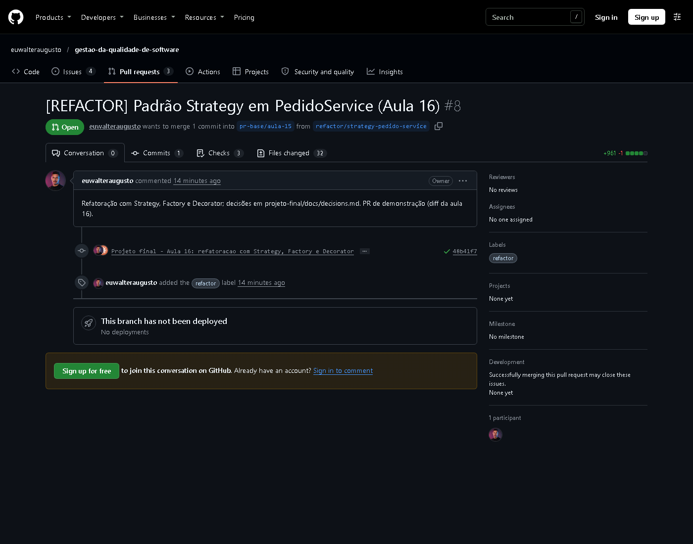
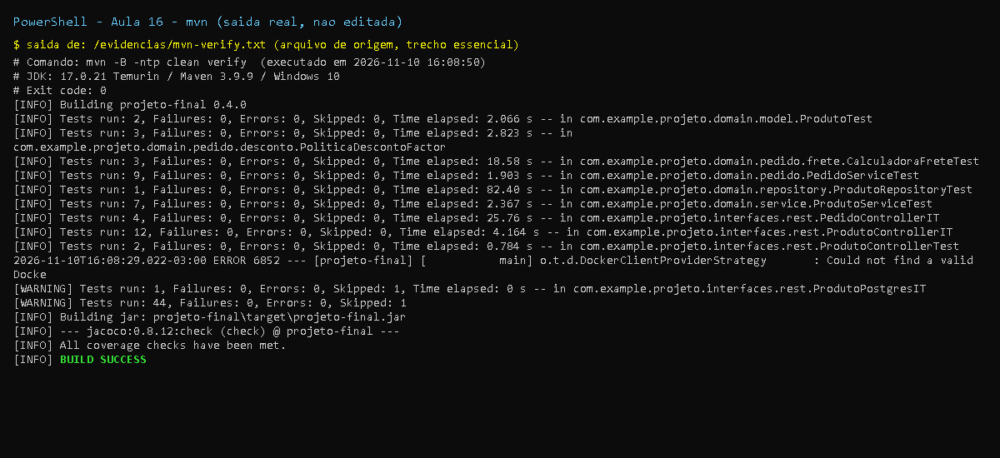

# Aula 16 - Refatoracao e Padroes de Projeto

## Objetivo

Identificar code smells, aplicar padroes de projeto e refatorar com seguranca, protegido por testes.

## Cenario: servico de pedidos (US-003)

O slide parte de um `PedidoService` legado (fora do projeto ate entao). Ele foi trazido para o
dominio de Produtos como **US-003 - total do pedido com desconto por tipo de cliente**: os itens
referenciam produtos do catalogo e o preco vem do banco.

### Codigo original (problematico, do slide)

```java
public BigDecimal calcularTotal(Pedido pedido, String tipoCliente) {
    BigDecimal total = BigDecimal.ZERO;
    for (ItemPedido item : pedido.getItens()) {                       // responsabilidade 1
        total = total.add(item.getPreco().multiply(new BigDecimal(item.getQuantidade())));
    }
    switch (tipoCliente) {                                           // responsabilidade 2
        case "VIP": total = total.multiply(new BigDecimal("0.9")); break;
        case "PREMIUM": total = total.multiply(new BigDecimal("0.8")); break;
    }
    if (total.compareTo(new BigDecimal("100")) < 0) {                // responsabilidade 3
        total = total.add(new BigDecimal("15"));
    }
    return total;
}
```

| Code smell | Onde | Refatoracao / padrao aplicado |
|------------|------|-------------------------------|
| Long Method (3 responsabilidades) | `calcularTotal` | Extract/Move Method + delegacao |
| Switch Statement / aberto para modificacao | `switch (tipoCliente)` | **Strategy** (`PoliticaDesconto`) + **Factory** (`PoliticaDescontoFactory`) |
| Primitive Obsession | `String tipoCliente` | `enum TipoCliente` |
| Feature Envy | servico calcula `preco * quantidade` | `ItemPedido#subtotal()` (Move Method), `Pedido#subtotal()` |
| Numeros magicos | `100`, `15` | `app.frete.valor-minimo-frete-gratis` / `app.frete.valor-fixo` |
| Logging misturado a regra (tarefa pos-aula) | - | **Decorator** `CalculadoraFreteComLog` |

### Padroes aplicados (3)

1. **Strategy** - `PoliticaDesconto` com `DescontoVIP` (10%), `DescontoPremium` (20%) e `SemDesconto`
   (REGULAR). Base `DescontoPercentual` concentra a conta e o arredondamento monetario.
2. **Factory** - `PoliticaDescontoFactory` escolhe a estrategia por `TipoCliente`; recebe as estrategias
   injetadas pelo Spring e falha na subida se faltar/duplicar alguma. Novo desconto = nova classe `@Component`.
3. **Decorator** - `CalculadoraFreteComLog` envolve `FreteFixo` (montado em `FreteConfig`), adicionando
   log e tempo de execucao sem tocar na regra.

Endpoint novo: `POST /pedidos/total` (`PedidoController`) -> `{subtotal, desconto, frete, total}`.
Decisoes registradas em [`docs/decisions.md`](../decisions.md) (tarefa pos-aula).

### Metricas antes x depois (complexidade ciclomatica, contagem manual por metodo)

| Metodo | Antes | Depois |
|--------|-------|--------|
| `PedidoService.calcularTotal` | 5 (for + 2 cases + default implicito + if) | 1 |
| `PoliticaDesconto.aplicarDesconto` | - | 1 por estrategia |
| `FreteFixo.calcular` | - | 2 |

O contador `COMPLEXITY` do JaCoCo por metodo (extraido de `jacoco.xml` em
[`evidencias/complexidade-ciclomatica.txt`](evidencias/complexidade-ciclomatica.txt)) confirma
complexidade **1** para `PedidoService.calcularTotal` e no maximo 5 em qualquer metodo do pacote
(o construtor da factory, que valida as estrategias). A comparacao de *code smells* no SonarQube (`mvn sonar:sonar`)
**nao foi executada localmente** (sem servidor Sonar) - roda no workflow `projeto-final-sonar.yml`
quando o secret existir.

### Refatoracao segura

Os 5 cenarios do comportamento legado (REGULAR com/sem frete, VIP, PREMIUM, PREMIUM que cai abaixo de
100 e paga frete) viraram um teste parametrizado (`PedidoServiceTest#deveAplicarDescontoEFreteConformeTipoDeCliente`)
e o teste do slide (`deveCalcularTotalComDescontoVIP`, estrategia real + frete mockado) foi mantido.

## Arquivos adicionados/alterados nesta aula

```
M projeto-final/pom.xml                     (versao 0.4.0)
M projeto-final/README.md
M projeto-final/src/main/resources/application.yml          (app.frete.*)
A projeto-final/src/main/java/com/example/projeto/config/FreteConfig.java
A projeto-final/src/main/java/com/example/projeto/domain/pedido/{TipoCliente,ItemPedido,Pedido,ResumoPedido,PedidoService}.java
A projeto-final/src/main/java/com/example/projeto/domain/pedido/desconto/{PoliticaDesconto,DescontoPercentual,DescontoVIP,DescontoPremium,SemDesconto,PoliticaDescontoFactory}.java
A projeto-final/src/main/java/com/example/projeto/domain/pedido/frete/{CalculadoraFrete,FreteFixo,CalculadoraFreteComLog}.java
A projeto-final/src/main/java/com/example/projeto/interfaces/rest/{PedidoController,PedidoRequest}.java
M projeto-final/src/main/java/com/example/projeto/interfaces/rest/ApiExceptionHandler.java (400 para JSON/enum invalido)
A projeto-final/src/test/java/com/example/projeto/domain/pedido/PedidoServiceTest.java
A projeto-final/src/test/java/com/example/projeto/domain/pedido/desconto/PoliticaDescontoFactoryTest.java
A projeto-final/src/test/java/com/example/projeto/domain/pedido/frete/CalculadoraFreteTest.java
A projeto-final/src/test/java/com/example/projeto/interfaces/rest/PedidoControllerIT.java
A projeto-final/docs/decisions.md
A projeto-final/docs/aula-16/README.md
A projeto-final/docs/aula-16/evidencias/*
```

Patch exato: [`mudancas.patch`](mudancas.patch).

## Correcoes em relacao aos slides

| Slide | Problema | Correcao |
|-------|----------|----------|
| `new BigDecimal(item.getQuantidade())` | Construtor `BigDecimal(int)` funciona, mas e inconsistente com a versao refatorada | `BigDecimal.valueOf(quantidade)` |
| `total.multiply(new BigDecimal("0.9"))` sem arredondamento | Escala cresce a cada operacao (ex.: `90.000`) - comparacoes com `equals` falham | `setScale(2, HALF_UP)` nas estrategias |
| Teste do slide: `assertEquals(new BigDecimal("90"), ...)` com frete mockado devolvendo o total | Mock esconde o calculo real; `equals` de `BigDecimal` considera escala | `CalculadoraFrete` devolve so o frete; asserts com valores de escala 2 / `compareTo` |
| `PedidoService(PoliticaDesconto strategy, ...)` | Estrategia fixa por instancia: um servico singleton do Spring nao consegue atender VIP e PREMIUM ao mesmo tempo | Estrategia escolhida por requisicao via `PoliticaDescontoFactory` |
| `switch` sem `default` | Tipo desconhecido passava sem desconto silenciosamente | `enum` + factory que valida todos os tipos na subida |

## Evidencias

- [`evidencias/mvn-verify.txt`](evidencias/mvn-verify.txt)
- [`evidencias/jacoco-resumo.txt`](evidencias/jacoco-resumo.txt)
- [`evidencias/curl-endpoints.txt`](evidencias/curl-endpoints.txt) - `POST /pedidos/total` para REGULAR/VIP/PREMIUM
- [`evidencias/log-decorator.txt`](evidencias/log-decorator.txt) - linhas de log geradas pelo Decorator durante as chamadas
- [`evidencias/complexidade-ciclomatica.txt`](evidencias/complexidade-ciclomatica.txt) - complexidade por metodo (JaCoCo)

Resultado: **44 testes, 0 falhas, 1 skipped** (`ProdutoPostgresIT`, sem Docker local); cobertura
**100% de linhas (130/130) e de branches (24/24)**. Observacao: nas respostas o `frete` aparece como
`15.0`/`0` (escala vinda do YAML) - ajustado para `15.00`/`0.00` na aula 17.

## Prints

- `print-testes-*`: captura renderizada a partir da saida real do comando, salva em `evidencias/*.txt`.
- `print-github-*` (e `print-pr*`, `print-actions`): captura real da pagina publica do GitHub.
- Demais imagens (JaCoCo, Swagger, paginas): capturas reais geradas durante a execucao.





