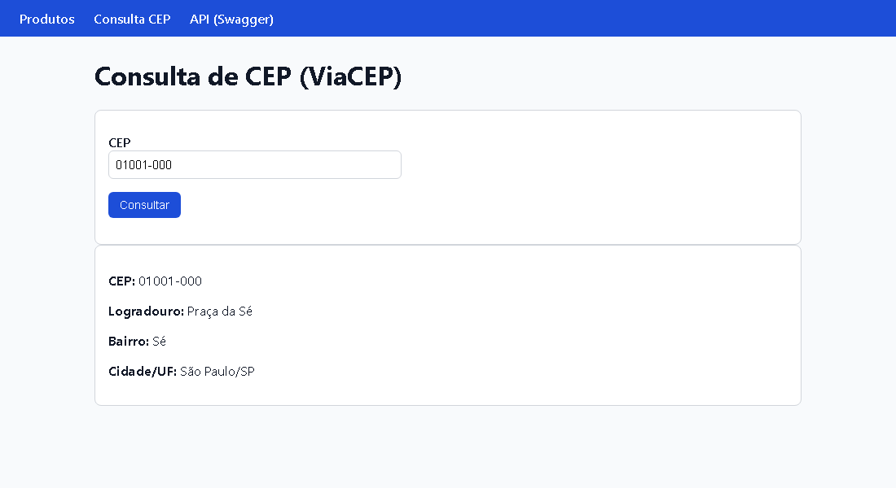
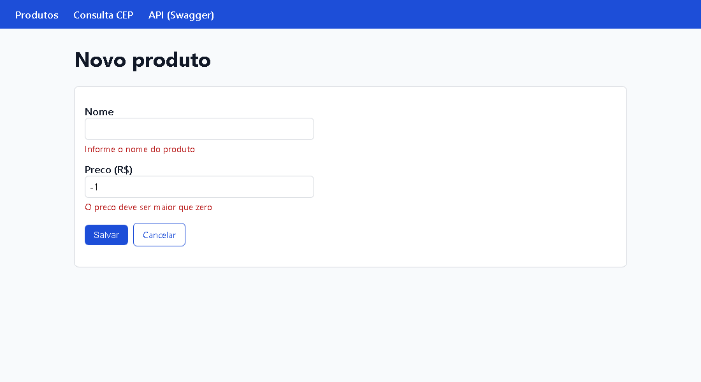
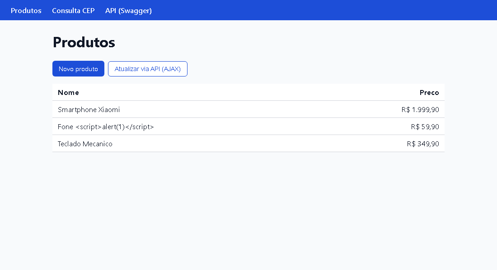
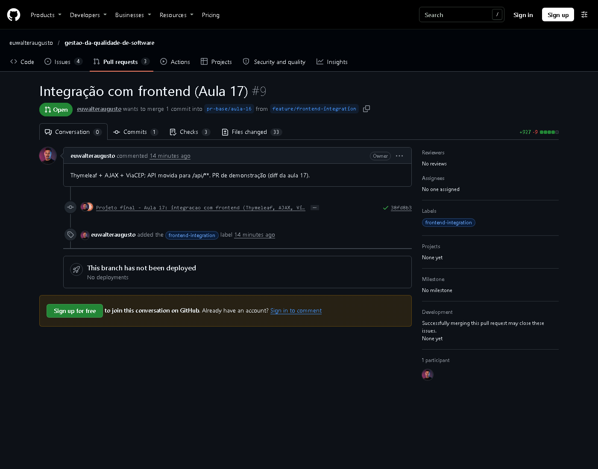
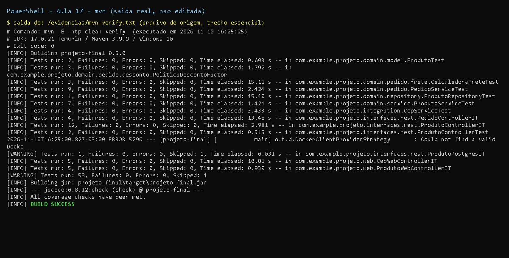

# Aula 17 - Integracao Frontend-Backend (Thymeleaf + API externa)

## Objetivo

Integrar um frontend server-side (Thymeleaf) ao backend, consumir uma API REST externa com cliente
HTTP Java e tratar erros no frontend.

## Abordagem escolhida: **hibrida**

| Camada | Caminho | Tecnologia |
|--------|---------|------------|
| Paginas server-side | `/produtos`, `/produtos/novo`, `/cep` | Thymeleaf + `@Controller` |
| API REST (JSON) | `/api/produtos`, `/api/pedidos` | `@RestController` |
| AJAX na pagina | botao "Atualizar via API" chama `fetch('/api/produtos')` | JavaScript |

Para as paginas e a API conviverem, a API REST foi movida de `/produtos` para **`/api/produtos`**
(e `/pedidos` para `/api/pedidos`), exatamente o caminho usado pelo exemplo AJAX do slide e pela
aula 18 (`GET /api/produtos` com JWT). Os testes de integracao foram atualizados.

Fluxo (diagrama `Aula_17_IQS.png`): Browser -> `ProdutoWebController` -> `ProdutoService` ->
`ProdutoRepository` -> `List<Produto>` -> Model -> HTML.

## Entregas (checklist)

- [x] **Pagina Thymeleaf funcional**: listagem (`produtos/lista.html`) e formulario de cadastro com
  validacao (`produtos/form.html`, `ProdutoForm` + `@Valid` + `BindingResult`, padrao PRG)
- [x] **Integracao com API externa**: `CepService` (ViaCEP) com `RestTemplate` + pagina `/cep`
- [x] **Tratamento de erros basico**: `WebExceptionHandler` (`RestClientException` -> 502, CEP inexistente -> 404,
  CEP invalido -> 400) + template `error.html` (tambem usado pelo Spring Boot para erros genericos)
- [x] **Tarefa pos-aula**: animacao de carregamento durante a chamada AJAX (`spinner` em `lista.html`)
- [ ] **Tarefa pos-aula**: dropdown de categorias consumindo outra API - **nao implementado**
  (o dominio `Produto` nao tem categoria; ficou registrado como sugestao de User Story futura)
- [ ] PR com label `frontend-integration` - **a cargo do dono do repositorio**

## Arquivos adicionados/alterados nesta aula

```
M projeto-final/pom.xml                                    (0.5.0 + spring-boot-starter-thymeleaf)
M projeto-final/README.md
M projeto-final/src/main/resources/application.yml         (app.viacep.*)
M projeto-final/src/main/java/com/example/projeto/interfaces/rest/ProdutoController.java (/api/produtos)
M projeto-final/src/main/java/com/example/projeto/interfaces/rest/PedidoController.java  (/api/pedidos)
M projeto-final/src/main/java/com/example/projeto/domain/pedido/frete/FreteFixo.java     (frete com escala 2: 15.00 / 0.00)
A projeto-final/src/main/java/com/example/projeto/integration/{CepService,Endereco,CepNaoEncontradoException}.java
A projeto-final/src/main/java/com/example/projeto/web/{ProdutoWebController,ProdutoForm,CepWebController,HomeController,WebExceptionHandler}.java
A projeto-final/src/main/resources/templates/{produtos/lista.html,produtos/form.html,cep.html,error.html,fragments/cabecalho.html}
A projeto-final/src/main/resources/static/css/app.css
M projeto-final/src/test/java/com/example/projeto/interfaces/rest/{ProdutoControllerIT,PedidoControllerIT,ProdutoPostgresIT}.java (novas URLs)
A projeto-final/src/test/java/com/example/projeto/integration/CepServiceTest.java
A projeto-final/src/test/java/com/example/projeto/web/{ProdutoWebControllerIT,CepWebControllerIT}.java
A projeto-final/docs/aula-17/README.md
A projeto-final/docs/aula-17/evidencias/*
```

Patch exato: [`mudancas.patch`](mudancas.patch).

## Correcoes em relacao aos slides

| Slide | Problema | Correcao |
|-------|----------|----------|
| `web/ProdutoController` com `@Controller` | Ja existe `interfaces.rest.ProdutoController`: dois beans `produtoController` -> `ConflictingBeanDefinitionException`; e ambos mapeados em `/produtos` -> mapeamento ambiguo | Classe `ProdutoWebController`; API movida para `/api/produtos` |
| `cadastrar(@Valid ProdutoForm form, ...)` + template `th:object="${form}"` | O atributo do modelo se chamaria `produtoForm`; ao reexibir o formulario com erros o Thymeleaf nao encontra `form` (erro 500) | `@ModelAttribute("form")` e `GET /produtos/novo` populando `form` |
| `CepService` com `private final RestTemplate restTemplate;` sem construtor/bean | Nao ha bean `RestTemplate` no Spring Boot -> a app nao sobe | `RestTemplate` criado via `RestTemplateBuilder` (timeouts de 3s configuraveis) |
| `"https://viacep.com.br/ws/" + cep + "/json/"` | Concatenacao de entrada do usuario na URL (injecao de caminho, ex.: `../`) | CEP validado (8 digitos) e passado como variavel de URI `/{cep}/json/`; URL base em propriedade |
| ViaCEP responde `200 {"erro": true}` para CEP inexistente | O slide trataria como endereco valido vazio | `CepNaoEncontradoException` -> pagina de erro 404 |
| `WebExceptionHandler` devolve `"error"` | Status HTTP 200 numa pagina de erro; o advice global tambem capturaria erros da API REST | `@ResponseStatus(BAD_GATEWAY)` e `@ControllerAdvice(basePackages = "...web")` |
| `#numbers.formatCurrency(produto.preco)` | Depende do locale do servidor (no Linux do Heroku sairia `$`/`¤`) e falha com preco nulo | `'R$ ' + #numbers.formatDecimal(produto.precoFormatado, 1, 'POINT', 2, 'COMMA')` (usa o getter null-safe da aula 15) |
| AJAX "atualiza tabela dinamicamente" | Montar HTML com `innerHTML` a partir do JSON abriria XSS | Celulas criadas com `textContent`; `catch`/`finally` para erro e spinner |

## Evidencias

- [`evidencias/mvn-verify.txt`](evidencias/mvn-verify.txt), [`evidencias/jacoco-resumo.txt`](evidencias/jacoco-resumo.txt)
- [`evidencias/curl-endpoints.txt`](evidencias/curl-endpoints.txt) - paginas, formulario (PRG), `/api/produtos`, CEP real no ViaCEP e CEP invalido
- [`evidencias/pagina-produtos.png`](evidencias/pagina-produtos.png), [`evidencias/pagina-form-erros.png`](evidencias/pagina-form-erros.png),
  [`evidencias/pagina-cep.png`](evidencias/pagina-cep.png) - capturas das paginas (Edge headless)

Resultado: **58 testes, 0 falhas, 1 skipped** (`ProdutoPostgresIT`); cobertura **100% de linhas
(179/179), 94,7% de branches**. A consulta real ao ViaCEP (`01001-000` -> Praca da Se, Sao Paulo/SP)
foi feita contra a API publica durante a execucao local. A evidencia mostra tambem que um nome com
`<script>` e exibido escapado (`&lt;script&gt;`) pelo Thymeleaf.

## Prints

- `print-testes-*`: captura renderizada a partir da saida real do comando, salva em `evidencias/*.txt`.
- `print-github-*` (e `print-pr*`, `print-actions`): captura real da pagina publica do GitHub.
- Demais imagens (JaCoCo, Swagger, paginas): capturas reais geradas durante a execucao.











