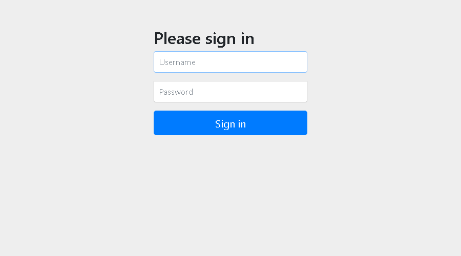
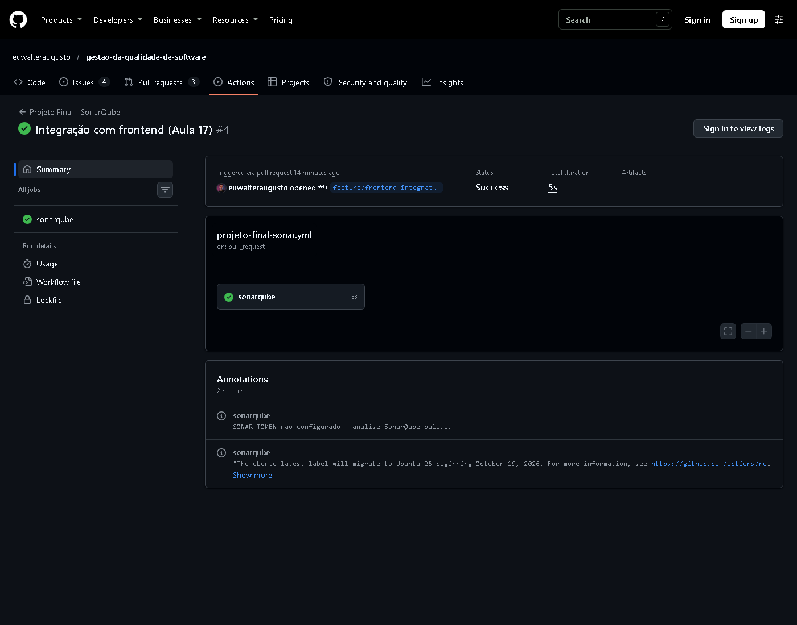
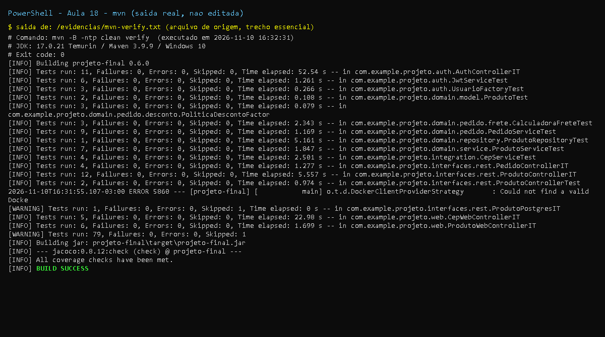
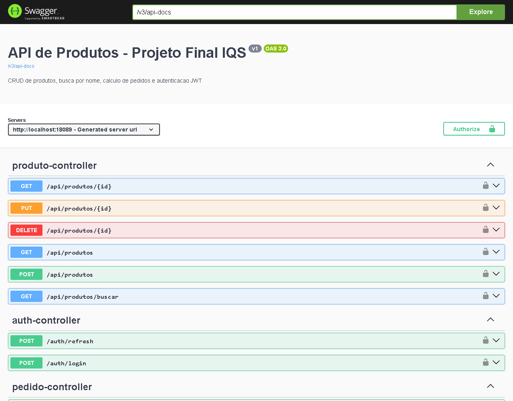

# Aula 18 - Autenticacao e Autorizacao com Spring Security (JWT)

## Objetivo

Autenticacao JWT, controle de acesso por papeis (roles) e testes com chamadas autenticadas.

## Entregas (checklist)

- [x] **Rota de login gerando JWT**: `POST /auth/login` -> `accessToken` + `refreshToken` (`AuthController`)
- [x] **Endpoint protegido acessivel apenas com token**: `/api/**` exige `Authorization: Bearer` (401 sem token)
- [x] **Controle por roles**: `ADMIN` altera o catalogo, `USER` so le (`@PreAuthorize`, dica da aula) -> 403
- [x] **Testes documentados** em [`docs/auth-guide.md`](../auth-guide.md) (curl + roteiro Postman)
- [x] **Tarefa pos-aula: refresh tokens** - `POST /auth/refresh` com rotacao do par de tokens
- [x] **Tarefa pos-aula: controle de roles no frontend** - `sec:authorize` (botao "Novo produto" so para ADMIN,
  nome/perfil do usuario e "Sair" no cabecalho) + login por formulario nas paginas web
- [x] **Factory Method para usuarios** (tarefa pos-aula 16) - `UsuarioFactory` (registrado em `docs/decisions.md`)
- [x] Swagger com esquema `bearerAuth` (botao *Authorize*)

Componentes (tabela do slide):

| Componente | Implementacao |
|------------|---------------|
| `SecurityFilterChain` | `SecurityConfig` - duas cadeias: API (JWT, sem sessao) e Web (form login, CSRF) |
| `UserDetailsService` | `InMemoryUserDetailsManager` com usuarios criados pela `UsuarioFactory` (senhas BCrypt) |
| `JwtAuthenticationFilter` | `JwtAuthFilter` (valida access token e popula o `SecurityContext`) |
| geracao/validacao de token | `JwtService` (jjwt 0.12.6, HS256, claims `typ`/`roles`/`iss`/`jti`) |

## Arquivos adicionados/alterados nesta aula

```
M projeto-final/pom.xml                    (0.6.0; security, jjwt-api/impl/jackson, thymeleaf-extras-springsecurity6, spring-security-test)
M projeto-final/README.md
M projeto-final/docs/decisions.md          (Factory Method de usuarios)
M projeto-final/src/main/resources/application.yml       (profiles.default=dev, app.jwt.*, app.security.*, h2-console off)
A projeto-final/src/main/resources/application-dev.yml   (defaults SOMENTE de dev: chave JWT e hashes BCrypt)
A projeto-final/src/main/java/com/example/projeto/auth/{AuthController,JwtService,JwtAuthFilter,JwtProperties,TokenInvalidoException,UsuarioFactory,UsuariosProperties}.java
A projeto-final/src/main/java/com/example/projeto/config/{SecurityConfig,OpenApiConfig}.java
M projeto-final/src/main/java/com/example/projeto/interfaces/rest/ProdutoController.java (@PreAuthorize ADMIN nas escritas)
M projeto-final/src/main/java/com/example/projeto/web/ProdutoWebController.java          (@PreAuthorize ADMIN no cadastro)
M projeto-final/src/main/resources/templates/{fragments/cabecalho.html,produtos/lista.html} (sec:authorize)
A projeto-final/src/test/java/com/example/projeto/auth/{AuthControllerIT,JwtServiceTest,UsuarioFactoryTest}.java
M projeto-final/src/test/java/com/example/projeto/interfaces/rest/{ProdutoControllerIT,PedidoControllerIT,ProdutoPostgresIT}.java (token JWT real)
M projeto-final/src/test/java/com/example/projeto/web/{ProdutoWebControllerIT,CepWebControllerIT}.java (@WithMockUser + csrf)
A projeto-final/docs/auth-guide.md
A projeto-final/docs/aula-18/README.md
A projeto-final/docs/aula-18/evidencias/*
```

Patch exato: [`mudancas.patch`](mudancas.patch).

## Correcoes em relacao aos slides

| Slide | Problema | Correcao |
|-------|----------|----------|
| So `jjwt-api` 0.11.5 no pom | `jjwt-api` contem apenas interfaces: em runtime falha com `UnknownClassException: ...DefaultJwtBuilder` (faltam `jjwt-impl` e `jjwt-jackson`) | `jjwt-api` + `jjwt-impl` (runtime) + `jjwt-jackson` (runtime), versao 0.12.6 |
| `SECRET_KEY = "mySecretKey123!"` hardcoded | Segredo versionado no Git; e com 15 bytes, curto demais para HS256 (jjwt 0.12 recusa chaves < 256 bits) | `app.jwt.secret` lido de `JWT_SECRET`; default **apenas** no perfil `dev`; validacao de >= 32 bytes na subida; em `prod` sem a variavel a app nao sobe |
| `.signWith(SignatureAlgorithm.HS256, SECRET_KEY)`, `setSubject`, `Jwts.parser()...` | API depreciada/removida no jjwt 0.12 | `signWith(SecretKey, Jwts.SIG.HS256)`, `subject()`, `parser().verifyWith(...)` |
| `.csrf().disable()` | Sintaxe do Spring Security 5: removida no 6.1+ (nao compila no Boot 3.3) e desligava CSRF de tudo | DSL lambda `csrf(c -> c.ignoringRequestMatchers(...))`: ignora so `/auth/**` e requisicoes Bearer; sessoes web continuam protegidas |
| `jwtAuthFilter()` sem definicao; filtro sem dependencias | Nao compila; se fosse `@Component` o Boot o registraria tambem como filtro global (executa 2x) | `new JwtAuthFilter(jwtService, entryPoint)` dentro do `SecurityConfig` |
| Filtro ignora token invalido e segue | Token expirado resultava em 403 enganoso | Token presente e invalido -> 401 JSON (`AuthenticationEntryPoint`) |
| Login `admin` / `123456` | Senha fraca e em texto puro | Usuarios em memoria com **hash BCrypt** (`{bcrypt}`), senhas de dev documentadas no auth-guide; em prod hashes por variavel de ambiente (`ADMIN_PASSWORD_HASH`, `CLIENTE_PASSWORD_HASH`) |
| Refresh: `validateToken(refreshToken)` aceita qualquer token | Um access token roubado serviria para renovar indefinidamente | Claim `typ` (`access`/`refresh`) verificada nos dois sentidos; refresh rotaciona o par |
| `InvalidTokenException`, `userService` | Classes inexistentes | `TokenInvalidoException`, `UserDetailsService` |
| `requestMatchers("/auth/**")` numa cadeia unica | Paginas Thymeleaf (aula 17) ficariam sem login e o AJAX quebraria | Duas cadeias (API JWT / Web form login) |

## Evidencias

- [`evidencias/mvn-verify.txt`](evidencias/mvn-verify.txt), [`evidencias/jacoco-resumo.txt`](evidencias/jacoco-resumo.txt)
- [`evidencias/curl-endpoints.txt`](evidencias/curl-endpoints.txt) - login, 401 sem token, 200 com token, 403 para `cliente`, 201 para `admin`, refresh, token trocado
- [`evidencias/swagger-ui.png`](evidencias/swagger-ui.png) - Swagger UI com o botao *Authorize* (bearerAuth)
- [`evidencias/pagina-login.png`](evidencias/pagina-login.png) - login por formulario das paginas web

Resultado: **79 testes, 0 falhas, 1 skipped** (`ProdutoPostgresIT`); cobertura **100% de linhas
(322/322), 91,9% de branches**. Os testes da API usam um **JWT real** (`support/MockMvcComJwt`), entao
passam pelo filtro e pelo `@PreAuthorize` de verdade; o fluxo completo esta em `AuthControllerIT` (11 cenarios).
Nas evidencias os tokens aparecem encurtados (sao de desenvolvimento e expiram em 15 min).

## Prints

- `print-testes-*`: captura renderizada a partir da saida real do comando, salva em `evidencias/*.txt`.
- `print-github-*` (e `print-pr*`, `print-actions`): captura real da pagina publica do GitHub.
- Demais imagens (JaCoCo, Swagger, paginas): capturas reais geradas durante a execucao.









